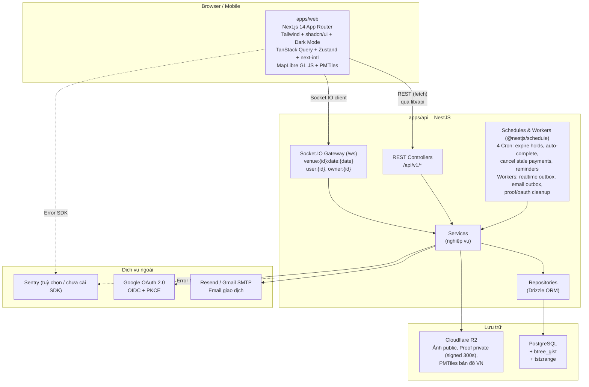
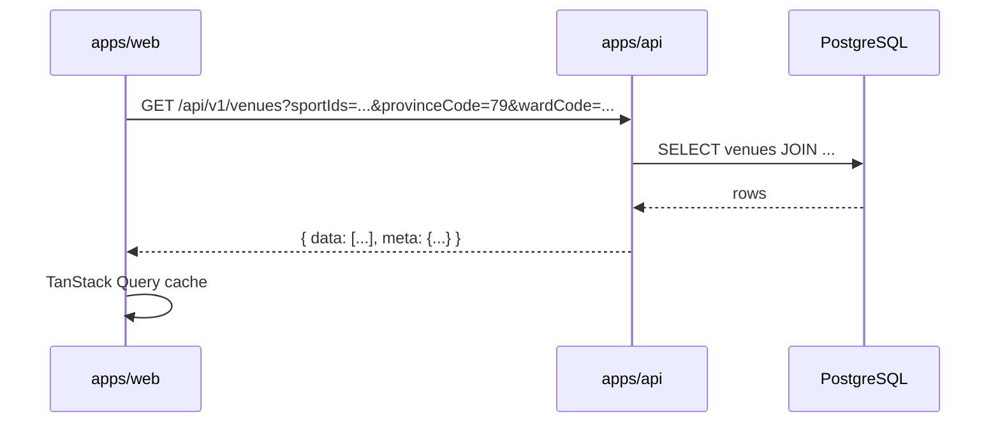
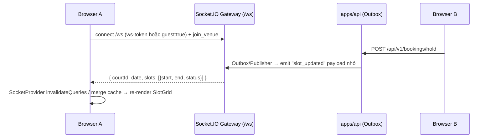

# 03 – Kiến trúc hệ thống

> **Phiên bản:** 1.3.0 | **Cập nhật lần cuối:** 2026-11-21

## Sơ đồ tổng thể



## Phiên bản stack (ghim cứng)

Mọi phiên bản dưới đây là **bắt buộc**; đổi phiên bản phải mở ADR mới. Code mẫu trong `docs/` viết theo đúng các phiên bản này — đặc biệt là cú pháp TanStack Query (xem ghi chú bên dưới).

| Thành phần | Phiên bản | Ghi chú |
|-----------|-----------|---------|
| Node.js | 20 LTS | Khớp `setup-node` trong `.github/workflows/ci.yml` |
| pnpm | 9 | Khớp `PNPM_VERSION` trong CI |
| TypeScript | 5.6.x | |
| Next.js | 14.2.x (App Router) | |
| React | 18.3.x | |
| **TanStack Query** | **5.6x** | **Cú pháp v5, KHÔNG dùng cú pháp v4** |
| Zustand | 4.5.x | State UI phía client |
| Tailwind CSS | 3.4.x | Hỗ trợ Dark Mode qua `class` |
| NestJS | 10.x | |
| Drizzle ORM | 0.36.x | |
| PostgreSQL | 16 | Có `btree_gist`, `tstzrange`, `pg_trgm`, `unaccent` |
| Socket.IO | 4.8.x | Gateway namespace `/ws` |
| Zod | 3.23.x | Schema validation dùng chung trong `packages/shared` |
| date-fns | 4.x | Xử lý ngày giờ múi giờ VN (`Asia/Ho_Chi_Minh`) |
| next-intl | 3.26.x | Đa ngôn ngữ FE (`messages/vi.json`) |
| MapLibre GL JS + react-map-gl + pmtiles | 6.x / 8.x / 3.x | Bản đồ WebGL tự chủ (PMTiles trên Cloudflare R2) |
| Recharts | 2.14.x | Biểu đồ doanh thu / thống kê Owner & Admin |
| Vitest & Playwright | 2.1.x / 1.49.x | Unit/Component test & E2E browser test |

> **TanStack Query v5 – khác biệt cú pháp so với v4:** các hàm nhận *filters* (`invalidateQueries`, `refetchQueries`, `removeQueries`, `cancelQueries`, `resetQueries`) bắt buộc dùng **dạng object**: `invalidateQueries({ queryKey: ['slots', id, date] })`. Ngược lại, `setQueryData` / `getQueryData` nhận **queryKey trực tiếp (mảng)**: `setQueryData(['slots', id, date], updater)` — **không** bọc trong object. Code mẫu ở [05-booking-and-realtime.md](05-booking-and-realtime.md) đã theo đúng quy tắc này.

## Ranh giới trách nhiệm

| Tầng | Trách nhiệm | KHÔNG làm |
|------|-------------|-----------|
| **FE (apps/web)** | Hiển thị UI, SSR/SEO, gọi API qua `lib/api`, cache với TanStack Query, state UI với Zustand | Tính giá, tạo booking, validate quyền, gọi DB trực tiếp |
| **BE (apps/api)** | Nghiệp vụ, validate, auth, giá, booking, realtime, cron | Render HTML, phục vụ static asset |
| **packages/shared** | Zod schema, TypeScript type, hằng số trạng thái | Logic nghiệp vụ, import từ apps |
| **PostgreSQL** | Lưu trữ, EXCLUDE constraint chống trùng lịch, transaction | — |

## Luồng REST điển hình



## Luồng WebSocket (realtime)



### Xử lý mất kết nối WebSocket

1. Client lắng nghe sự kiện `disconnect`.
2. Khi reconnect, client gọi lại REST `GET /api/v1/venues/:id/slots?date=...` để đồng bộ toàn bộ trạng thái.
3. Optimistic UI: khi tạo hold, client cập nhật cache ngay lập tức; nếu API trả lỗi, rollback về trạng thái cũ.

## Nguyên tắc kiến trúc

1. **Nghiệp vụ chỉ ở apps/api và DB.** Controller chỉ nhận request, delegate cho service.
2. **Không tin client.** Giá tính ở server theo pricing_rules; client chỉ hiển thị.
3. **Tuyến phòng thủ chống trùng lịch:** Service kiểm tra → EXCLUDE constraint từ chối → trả 409.
4. **OpenAPI là nguồn sự thật duy nhất** cho hợp đồng FE↔BE. Cập nhật trước khi chia việc.
5. **packages/shared** là nguồn sự thật duy nhất cho type và hằng số. Không duplicate.

## Xử lý lỗi toàn tầng

```
DB constraint lỗi (23P01 - exclusion violation)
  → BookingService catch → ném ConflictException
  → Controller → GlobalExceptionFilter
  → Response: { error: { code: "BOOKING_CONFLICT", message: "...", httpStatus: 409 } }
  → FE hiển thị toast lỗi + rollback optimistic UI
```

Chi tiết định dạng lỗi xem `11-api-contract.md`.
