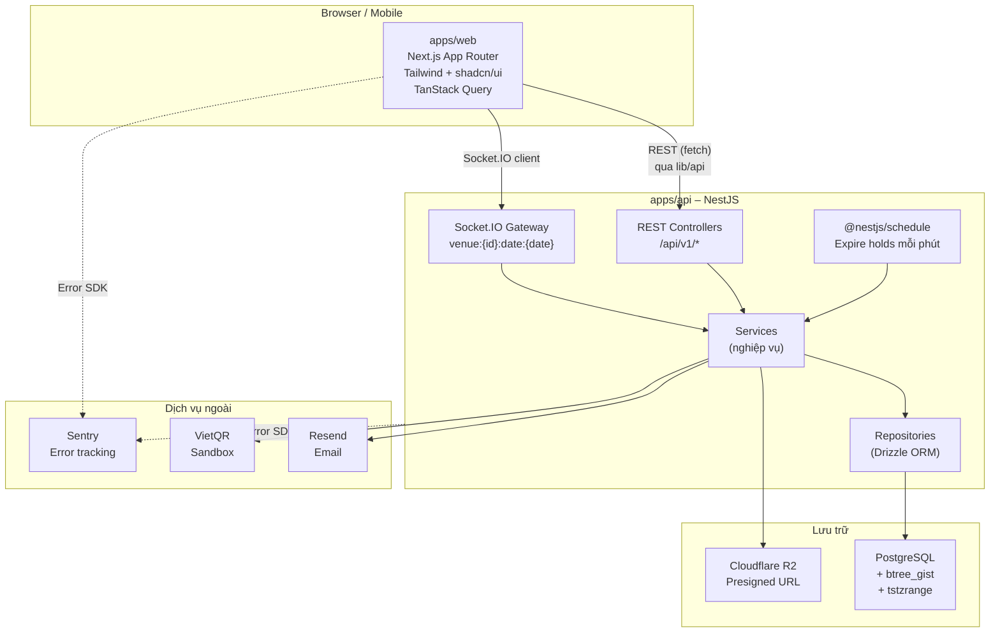
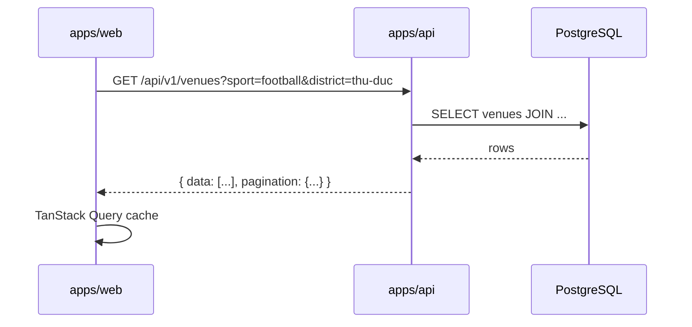
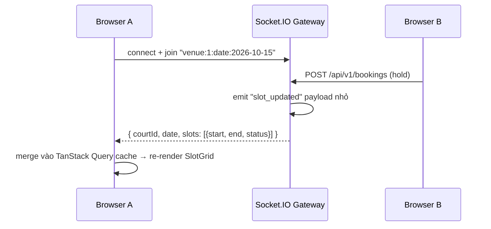

# 03 – Kiến trúc hệ thống

> **Phiên bản:** 1.0.0 | **Cập nhật lần cuối:** 2026-09-30

## Sơ đồ tổng thể



## Ranh giới trách nhiệm

| Tầng | Trách nhiệm | KHÔNG làm |
|------|-------------|-----------|
| **FE (apps/web)** | Hiển thị UI, SSR/SEO, gọi API qua `lib/api`, cache với TanStack Query, state UI với Zustand | Tính giá, tạo booking, validate quyền, gọi DB trực tiếp |
| **BE (apps/api)** | Nghiệp vụ, validate, auth, giá, booking, realtime, cron | Render HTML, phục vụ static asset |
| **packages/shared** | Zod schema, TypeScript type, hằng số trạng thái | Logic nghiệp vụ, import từ apps |
| **PostgreSQL** | Lưu trữ, EXCLUDE constraint chống trùng lịch, transaction | — |

## Luồng REST điển hình



## Luồng WebSocket (realtime)



### Xử lý mất kết nối WebSocket

1. Client lắng nghe sự kiện `disconnect`.
2. Khi reconnect, client gọi lại REST `GET /api/v1/venues/:id/slots?date=...` để đồng bộ toàn bộ trạng thái.
3. Optimistic UI: khi tạo hold, client cập nhật cache ngay lập tức; nếu API trả lỗi, rollback về trạng thái cũ.

## Nguyên tắc kiến trúc

1. **Nghiệp vụ chỉ ở apps/api và DB.** Controller chỉ nhận request, delegate cho service.
2. **Không tin client.** Giá tính ở server theo pricing_rules; client chỉ hiển thị.
3. **Tuyến phòng thủ chống trùng lịch:** Service kiểm tra → EXCLUDE constraint từ chối → trả 409.
4. **OpenAPI là nguồn sự thật duy nhất** cho hợp đồng FE↔BE. Cập nhật trước khi chia việc.
5. **packages/shared** là nguồn sự thật duy nhất cho type và hằng số. Không duplicate.

## Xử lý lỗi toàn tầng

```
DB constraint lỗi (23P01 - exclusion violation)
  → BookingService catch → ném ConflictException
  → Controller → GlobalExceptionFilter
  → Response: { error: { code: "BOOKING_CONFLICT", message: "...", httpStatus: 409 } }
  → FE hiển thị toast lỗi + rollback optimistic UI
```

Chi tiết định dạng lỗi xem `11-api-contract.md`.
