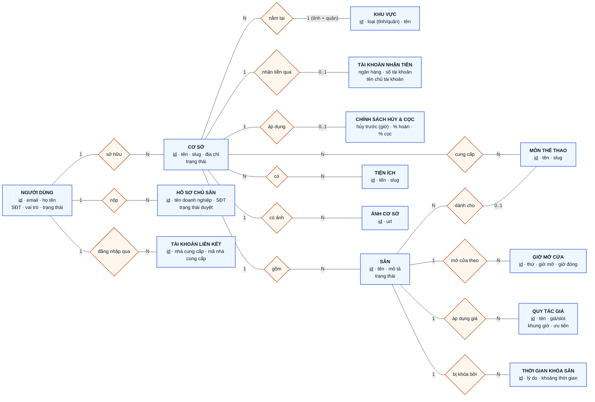
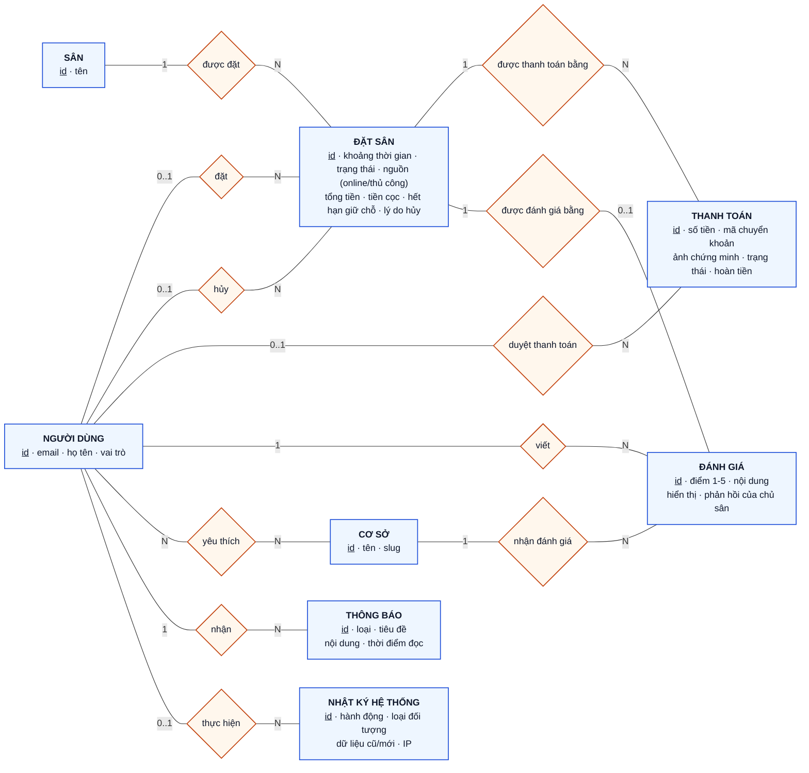

# 04 – Database Schema

> **Phiên bản:** 1.2.0 | **Cập nhật lần cuối:** 2026-10-07

## Quy ước chung

- **snake_case** cho tất cả tên bảng và cột.
- **Soft delete:** thêm cột `deleted_at TIMESTAMPTZ DEFAULT NULL`; query luôn filter `deleted_at IS NULL`.
- **Timestamps:** mọi bảng có `created_at TIMESTAMPTZ DEFAULT now()` và `updated_at TIMESTAMPTZ DEFAULT now()`.
- **UUID v7** làm primary key (sắp xếp theo thời gian, phù hợp index B-tree). PostgreSQL 16 chưa có `uuidv7()` gốc (có từ PG 18), nên **ID được sinh ở tầng ứng dụng** (`v7()` của thư viện `uuid`, gắn vào `$defaultFn` của Drizzle). Cột trong DB vẫn kiểu `UUID`. `DEFAULT gen_random_uuid()` (v4) trong SQL mẫu chỉ là phương án dự phòng cho seed hoặc SQL thủ công. Xem ADR-011.
- **Múi giờ:** Lưu UTC (timestamptz/tstzrange), hiển thị Asia/Ho_Chi_Minh ở FE/API response.
- **Migration:** Mọi thay đổi schema qua file migration có version (`0001_init.sql`, `0002_...sql`). KHÔNG sửa tay.

## ERD theo 3 cấp độ

Sơ đồ được vẽ theo 3 mức trừu tượng, từ nghiệp vụ đến cài đặt. Cả ba mô tả **cùng một schema**, chỉ khác mức chi tiết:

| Cấp độ                        | Mục đích                    | Có gì                                                                           | Không có gì                               |
| ----------------------------- | --------------------------- | ------------------------------------------------------------------------------- | ----------------------------------------- |
| **1. Conceptual** (khái niệm) | Trao đổi nghiệp vụ, báo cáo | Thực thể, thuộc tính chính, quan hệ (hình thoi), bản số; quan hệ N-N giữ nguyên | Khóa ngoại, bảng trung gian, kiểu dữ liệu |
| **2. Logical** (logic)        | Thiết kế dữ liệu            | Mọi thuộc tính nghiệp vụ, PK/FK/UK, bảng trung gian cho quan hệ N-N             | Kiểu dữ liệu riêng của PostgreSQL, index  |
| **3. Physical** (vật lý)      | Cài đặt migration           | Mọi cột, kiểu PostgreSQL, PK/FK/UK, ràng buộc chính                             | (SQL đầy đủ nằm ở mục "Chi tiết bảng")    |

Ký hiệu bản số: `1` = đúng một, `0..1` = không hoặc một, `N` = nhiều.

### 1. Conceptual ERD (Mô hình khái niệm)

Chỉ giữ thực thể nghiệp vụ. Bỏ `refresh_tokens` (chi tiết kỹ thuật của đăng nhập). Quan hệ N-N (**Cơ sở – Môn thể thao**, **Cơ sở – Tiện ích**, **Người dùng – Cơ sở yêu thích**) được vẽ thành hình thoi và chưa tách bảng. Chia 2 sơ đồ cho dễ đọc; **Người dùng** và **Cơ sở** xuất hiện ở cả hai.

**1a. Danh mục: cơ sở, sân, giá, giờ mở cửa**



**1b. Giao dịch: đặt sân, thanh toán, đánh giá, thông báo**



### 2. Logical ERD (Mô hình logic)

Các bước chuyển từ conceptual sang logical:

- Quan hệ N-N được tách thành bảng trung gian: `venue_sports`, `venue_amenities`, `favorites`.
- Quan hệ 1-N được biểu diễn bằng khóa ngoại (FK) ở phía "N".
- Thêm `refresh_tokens` (phần kỹ thuật của xác thực).
- Mọi thuộc tính nghiệp vụ đều có mặt. **Không vẽ** các cột chung `created_at`, `updated_at`, `deleted_at` và `sort_order` để sơ đồ gọn (xem bảng ở mục Physical).

```mermaid
erDiagram
    users {
        id id PK
        string email UK
        string password_hash "NULL nếu chỉ đăng nhập OAuth"
        string full_name
        string phone
        string avatar_url
        string role "customer, owner, admin"
        string status "active, suspended, pending"
        datetime email_verified_at "NULL = chưa xác thực"
    }
    auth_tokens {
        id id PK
        id user_id FK
        string type "email_verify, password_reset"
        string token_hash UK
        datetime expires_at
        datetime used_at
    }
    owner_applications {
        id id PK
        id user_id FK
        id reviewed_by FK "nullable"
        string business_name
        string phone
        string address
        string note
        string status "pending, approved, rejected"
        string review_note
        datetime reviewed_at
    }
    areas {
        id id PK
        id parent_id FK "nullable, NULL = tỉnh/thành"
        string type "province, district"
        string name
        string slug "UK cùng parent_id"
    }
    venue_payment_accounts {
        id venue_id PK, FK
        string bank_bin
        string account_no
        string account_name
    }
    cancellation_policies {
        id venue_id PK, FK
        int cancel_before_hours
        int refund_percent
        int deposit_percent
    }
    oauth_accounts {
        id id PK
        id user_id FK
        string provider "google"
        string provider_id "UK cùng provider"
    }
    refresh_tokens {
        id id PK
        id user_id FK
        string token_hash UK
        datetime expires_at
        boolean revoked
    }
    venues {
        id id PK
        id owner_id FK
        string name
        string slug UK
        text description
        string address
        id province_id FK "areas.type = province"
        id district_id FK "areas.type = district, con của province_id"
        decimal lat
        decimal lng
        string status "pending, approved, rejected, suspended"
        string cover_url
    }
    venue_images {
        id id PK
        id venue_id FK
        string url
    }
    sports {
        id id PK
        string name UK
        string slug UK
        string icon
    }
    amenities {
        id id PK
        string name UK
        string slug UK
        string icon
    }
    venue_sports {
        id venue_id PK, FK
        id sport_id PK, FK
    }
    venue_amenities {
        id venue_id PK, FK
        id amenity_id PK, FK
    }
    courts {
        id id PK
        id venue_id FK
        id sport_id FK "nullable"
        string name
        text description
        string status "active, inactive"
    }
    opening_hours {
        id id PK
        id court_id FK
        int day_of_week "0=CN ... 6=T7, UK cùng court_id"
        time open_time
        time close_time
    }
    pricing_rules {
        id id PK
        id court_id FK
        string name
        int price_per_slot "VND mỗi 30 phút"
        time start_time
        time end_time
        int_list day_of_week "NULL = mọi ngày"
        date date_override "ngày lễ"
        int priority
    }
    blackout_periods {
        id id PK
        id court_id FK
        string reason
        datetime_range during
    }
    bookings {
        id id PK
        id court_id FK
        id customer_id FK "nullable khi booking thủ công cho khách vãng lai"
        id created_by FK "nullable, Owner tạo booking thủ công"
        id cancelled_by FK "nullable"
        string source "online, manual"
        string guest_name "chỉ khi manual"
        string guest_phone "chỉ khi manual"
        datetime_range during
        string status "held, pending_payment, confirmed, completed, cancelled, expired, no_show"
        int total_price "VND, tính ở server"
        int deposit_amount "VND khách phải chuyển khoản"
        string note
        string cancel_reason
        datetime expires_at "chỉ dùng khi held"
    }
    payments {
        id id PK
        id booking_id FK
        id reviewed_by FK "nullable, Owner duyệt"
        int amount
        string provider "bank_transfer, cash"
        string transfer_code "nội dung chuyển khoản trong QR"
        string proof_url "ảnh chuyển khoản"
        string status "pending, submitted, completed, rejected, refunded"
        string reject_reason
        int refund_amount
        string idempotency_key UK "nullable, dành cho webhook sau này"
        datetime paid_at
    }
    reviews {
        id id PK
        id booking_id FK, UK
        id venue_id FK "suy ra từ booking, lưu thừa để truy vấn nhanh"
        id customer_id FK
        int rating "1..5"
        text content
        boolean is_visible
        text owner_reply "nullable"
        datetime owner_replied_at
    }
    favorites {
        id user_id PK, FK
        id venue_id PK, FK
    }
    notifications {
        id id PK
        id user_id FK
        string type
        string title
        string body
        json data
        datetime read_at
    }
    audit_logs {
        id id PK
        id actor_id FK "nullable"
        string action
        string entity_type
        id entity_id
        json old_data
        json new_data
        string ip_address
    }

    users ||--o{ oauth_accounts : "liên kết"
    users ||--o{ refresh_tokens : "có"
    users ||--o{ auth_tokens : "nhận"
    users ||--o{ owner_applications : "nộp"
    users |o--o{ owner_applications : "duyệt"
    users ||--o{ venues : "sở hữu"
    users |o--o{ bookings : "đặt"
    users |o--o{ bookings : "hủy"
    users |o--o{ bookings : "tạo thủ công"
    users |o--o{ payments : "duyệt"
    users ||--o{ reviews : "viết"
    users ||--o{ favorites : "yêu thích"
    users ||--o{ notifications : "nhận"
    users |o--o{ audit_logs : "thực hiện"

    areas |o--o{ areas : "gồm"
    areas ||--o{ venues : "tỉnh"
    areas ||--o{ venues : "quận"

    venues ||--o| venue_payment_accounts : "nhận tiền qua"
    venues ||--o| cancellation_policies : "áp dụng"
    venues ||--o{ venue_images : "có ảnh"
    venues ||--o{ courts : "gồm"
    venues ||--o{ venue_sports : "cung cấp"
    venues ||--o{ venue_amenities : "có"
    venues ||--o{ reviews : "nhận"
    venues ||--o{ favorites : "được yêu thích"

    sports ||--o{ venue_sports : "thuộc"
    sports |o--o{ courts : "dành cho"
    amenities ||--o{ venue_amenities : "thuộc"

    courts ||--o{ opening_hours : "mở cửa"
    courts ||--o{ pricing_rules : "áp dụng giá"
    courts ||--o{ blackout_periods : "bị khóa"
    courts ||--o{ bookings : "được đặt"

    bookings ||--o{ payments : "thanh toán"
    bookings ||--o| reviews : "được đánh giá"
```



### 3. Physical ERD (Mô hình vật lý)

Kiểu dữ liệu và ràng buộc là của PostgreSQL 16. Một số kiểu viết gọn vì Mermaid không cho dấu phẩy trong kiểu: `NUMERIC_10_7` là `NUMERIC(10,7)`. Cột `PK` kiểu `UUID`; giá trị là UUID v7 do ứng dụng sinh (SQL mẫu ghi `DEFAULT gen_random_uuid()` chỉ để dự phòng).

```mermaid
erDiagram
    users {
        UUID id PK
        TEXT email UK "NOT NULL"
        TEXT password_hash "NULL nếu OAuth only"
        TEXT full_name "NOT NULL"
        TEXT phone
        TEXT avatar_url
        TEXT role "CHECK customer, owner, admin"
        TEXT status "DEFAULT active, CHECK active, suspended, pending"
        TIMESTAMPTZ email_verified_at "NULL = chưa xác thực"
        TIMESTAMPTZ created_at "DEFAULT now()"
        TIMESTAMPTZ updated_at "DEFAULT now()"
        TIMESTAMPTZ deleted_at "soft delete"
    }
    oauth_accounts {
        UUID id PK
        UUID user_id FK "ON DELETE CASCADE"
        TEXT provider "CHECK google"
        TEXT provider_id "UNIQUE (provider, provider_id)"
        TIMESTAMPTZ created_at
    }
    refresh_tokens {
        UUID id PK
        UUID user_id FK "ON DELETE CASCADE"
        TEXT token_hash UK
        TIMESTAMPTZ expires_at
        BOOLEAN revoked "DEFAULT false"
        TIMESTAMPTZ created_at
    }
    auth_tokens {
        UUID id PK
        UUID user_id FK "ON DELETE CASCADE"
        TEXT type "CHECK email_verify, password_reset"
        TEXT token_hash UK
        TIMESTAMPTZ expires_at
        TIMESTAMPTZ used_at "NULL = chưa dùng"
        TIMESTAMPTZ created_at
    }
    owner_applications {
        UUID id PK
        UUID user_id FK
        TEXT business_name
        TEXT phone
        TEXT address
        TEXT note
        TEXT status "DEFAULT pending, CHECK pending, approved, rejected"
        TEXT review_note
        UUID reviewed_by FK "nullable"
        TIMESTAMPTZ reviewed_at
        TIMESTAMPTZ created_at
        TIMESTAMPTZ updated_at
    }
    areas {
        UUID id PK
        TEXT type "CHECK province, district"
        TEXT name
        TEXT slug "UNIQUE NULLS NOT DISTINCT (parent_id, slug)"
        UUID parent_id FK "NULL nếu là tỉnh, ON DELETE RESTRICT"
        TIMESTAMPTZ created_at
        TIMESTAMPTZ updated_at
    }
    venues {
        UUID id PK
        UUID owner_id FK
        TEXT name
        TEXT slug UK
        TEXT description
        TEXT address
        UUID province_id FK "areas, type = province"
        UUID district_id FK "areas, type = district"
        NUMERIC_10_7 lat "NUMERIC(10,7)"
        NUMERIC_10_7 lng "NUMERIC(10,7)"
        TEXT status "DEFAULT pending, CHECK pending, approved, rejected, suspended"
        TEXT cover_url
        TIMESTAMPTZ created_at
        TIMESTAMPTZ updated_at
        TIMESTAMPTZ deleted_at "soft delete"
    }
    venue_images {
        UUID id PK
        UUID venue_id FK "ON DELETE CASCADE"
        TEXT url
        INT sort_order "DEFAULT 0"
        TIMESTAMPTZ created_at
    }
    sports {
        UUID id PK
        TEXT name UK
        TEXT slug UK
        TEXT icon "tên icon lucide"
        INT sort_order "DEFAULT 0"
        TIMESTAMPTZ created_at
        TIMESTAMPTZ updated_at
    }
    amenities {
        UUID id PK
        TEXT name UK
        TEXT slug UK
        TEXT icon
        INT sort_order "DEFAULT 0"
        TIMESTAMPTZ created_at
        TIMESTAMPTZ updated_at
    }
    venue_sports {
        UUID venue_id PK, FK "ON DELETE CASCADE"
        UUID sport_id PK, FK "ON DELETE RESTRICT"
    }
    venue_amenities {
        UUID venue_id PK, FK "ON DELETE CASCADE"
        UUID amenity_id PK, FK "ON DELETE RESTRICT"
    }
    venue_payment_accounts {
        UUID venue_id PK, FK "ON DELETE CASCADE"
        TEXT bank_bin "mã BIN VietQR"
        TEXT account_no
        TEXT account_name
        TIMESTAMPTZ created_at
        TIMESTAMPTZ updated_at
    }
    cancellation_policies {
        UUID venue_id PK, FK "ON DELETE CASCADE"
        INT cancel_before_hours "DEFAULT 24, CHECK >= 0"
        INT refund_percent "DEFAULT 100, CHECK 0..100"
        INT deposit_percent "DEFAULT 100, CHECK 10..100"
        TIMESTAMPTZ created_at
        TIMESTAMPTZ updated_at
    }
    courts {
        UUID id PK
        UUID venue_id FK "ON DELETE CASCADE"
        UUID sport_id FK "nullable"
        TEXT name
        TEXT description
        TEXT status "DEFAULT active, CHECK active, inactive"
        INT sort_order "DEFAULT 0"
        TIMESTAMPTZ created_at
        TIMESTAMPTZ updated_at
        TIMESTAMPTZ deleted_at "soft delete"
    }
    opening_hours {
        UUID id PK
        UUID court_id FK "ON DELETE CASCADE"
        SMALLINT day_of_week "CHECK 0..6, UNIQUE (court_id, day_of_week)"
        TIME open_time "CHECK open_time trước close_time"
        TIME close_time
    }
    pricing_rules {
        UUID id PK
        UUID court_id FK "ON DELETE CASCADE"
        TEXT name
        INT price_per_slot "VND mỗi 30 phút"
        TIME start_time
        TIME end_time
        SMALLINT[] day_of_week "NULL = mọi ngày"
        DATE date_override "ngày lễ"
        INT priority "DEFAULT 0, cao hơn = ưu tiên hơn"
        TIMESTAMPTZ created_at
        TIMESTAMPTZ updated_at
    }
    blackout_periods {
        UUID id PK
        UUID court_id FK "ON DELETE CASCADE"
        TEXT reason
        TSTZRANGE during "NOT NULL, GiST (court_id, during)"
        TIMESTAMPTZ created_at
    }
    bookings {
        UUID id PK
        UUID court_id FK
        UUID customer_id FK "nullable khi booking thủ công cho khách vãng lai"
        UUID created_by FK "nullable, Owner tạo thủ công"
        UUID cancelled_by FK "nullable, tham chiếu users"
        TEXT source "DEFAULT online, CHECK online, manual"
        TEXT guest_name "chỉ khi manual"
        TEXT guest_phone "chỉ khi manual"
        TSTZRANGE during "UTC, NOT NULL"
        TEXT status "DEFAULT held, CHECK 7 trạng thái"
        INT total_price "VND, tính ở server"
        INT deposit_amount "VND khách phải chuyển khoản"
        TEXT note
        TEXT cancel_reason
        TIMESTAMPTZ expires_at "chỉ dùng khi held"
        TIMESTAMPTZ created_at
        TIMESTAMPTZ updated_at
    }
    payments {
        UUID id PK
        UUID booking_id FK
        UUID reviewed_by FK "nullable, Owner duyệt"
        INT amount
        TEXT provider "DEFAULT bank_transfer, CHECK bank_transfer, cash"
        TEXT transfer_code "nội dung chuyển khoản"
        TEXT proof_url "ảnh chuyển khoản"
        TIMESTAMPTZ proof_uploaded_at
        TEXT status "DEFAULT pending, CHECK pending, submitted, completed, rejected, refunded"
        TIMESTAMPTZ reviewed_at
        TEXT reject_reason
        INT refund_amount
        TIMESTAMPTZ refunded_at
        TEXT idempotency_key UK "nullable, dành cho webhook sau này"
        TIMESTAMPTZ paid_at
        TIMESTAMPTZ created_at
        TIMESTAMPTZ updated_at
    }
    reviews {
        UUID id PK
        UUID booking_id FK, UK
        UUID venue_id FK
        UUID customer_id FK
        SMALLINT rating "CHECK 1..5"
        TEXT content
        BOOLEAN is_visible "DEFAULT true"
        TEXT owner_reply "nullable"
        TIMESTAMPTZ owner_replied_at
        TIMESTAMPTZ created_at
        TIMESTAMPTZ updated_at
    }
    favorites {
        UUID user_id PK, FK "ON DELETE CASCADE"
        UUID venue_id PK, FK "ON DELETE CASCADE"
        TIMESTAMPTZ created_at
    }
    notifications {
        UUID id PK
        UUID user_id FK "ON DELETE CASCADE"
        TEXT type
        TEXT title
        TEXT body
        JSONB data
        TIMESTAMPTZ read_at
        TIMESTAMPTZ created_at
    }
    audit_logs {
        UUID id PK
        UUID actor_id FK "nullable"
        TEXT action
        TEXT entity_type
        UUID entity_id
        JSONB old_data
        JSONB new_data
        INET ip_address
        TIMESTAMPTZ created_at
    }

    users ||--o{ oauth_accounts : "user_id"
    users ||--o{ refresh_tokens : "user_id"
    users ||--o{ auth_tokens : "user_id"
    users ||--o{ owner_applications : "user_id"
    users |o--o{ owner_applications : "reviewed_by"
    users ||--o{ venues : "owner_id"
    users |o--o{ bookings : "customer_id"
    users |o--o{ bookings : "cancelled_by"
    users |o--o{ bookings : "created_by"
    users |o--o{ payments : "reviewed_by"
    users ||--o{ reviews : "customer_id"
    users ||--o{ favorites : "user_id"
    users ||--o{ notifications : "user_id"
    users |o--o{ audit_logs : "actor_id"

    areas |o--o{ areas : "parent_id"
    areas ||--o{ venues : "province_id"
    areas ||--o{ venues : "district_id"

    venues ||--o| venue_payment_accounts : "venue_id"
    venues ||--o| cancellation_policies : "venue_id"
    venues ||--o{ venue_images : "venue_id"
    venues ||--o{ courts : "venue_id"
    venues ||--o{ venue_sports : "venue_id"
    venues ||--o{ venue_amenities : "venue_id"
    venues ||--o{ reviews : "venue_id"
    venues ||--o{ favorites : "venue_id"

    sports ||--o{ venue_sports : "sport_id"
    sports |o--o{ courts : "sport_id"
    amenities ||--o{ venue_amenities : "amenity_id"

    courts ||--o{ opening_hours : "court_id"
    courts ||--o{ pricing_rules : "court_id"
    courts ||--o{ blackout_periods : "court_id"
    courts ||--o{ bookings : "court_id"

    bookings ||--o{ payments : "booking_id"
    bookings ||--o| reviews : "booking_id"
```



**Ràng buộc và index quan trọng** (không vẽ được trong ERD, SQL đầy đủ ở mục "Chi tiết bảng"):

| Bảng                        | Ràng buộc / index                                                                                                                 | Mục đích                                                                      |
| --------------------------- | --------------------------------------------------------------------------------------------------------------------------------- | ----------------------------------------------------------------------------- |
| `bookings`                  | `EXCLUDE USING gist (court_id WITH =, during WITH &&) WHERE (status IN ('held','pending_payment','confirmed'))`, cần `btree_gist` | **Chống trùng lịch ở DB** (Quy tắc #2)                                        |
| `bookings`                  | GiST `(court_id, during)`; B-tree `customer_id`, `status`; `expires_at WHERE status='held'`                                       | Truy vấn lịch sân, dọn booking hết hạn giữ chỗ                                |
| `blackout_periods`          | GiST `(court_id, during)`                                                                                                         | Kiểm tra sân bị khóa                                                          |
| `opening_hours`             | `UNIQUE (court_id, day_of_week)`, `CHECK (open_time < close_time)`                                                                | Mỗi sân một khung giờ mở cửa mỗi thứ                                          |
| `reviews`                   | `UNIQUE (booking_id)`                                                                                                             | Một booking chỉ được đánh giá một lần                                         |
| `payments`                  | `UNIQUE (idempotency_key)`; partial unique `(booking_id) WHERE status IN ('pending','submitted','completed')`                     | Chống webhook trùng (sau này); mỗi booking chỉ có một thanh toán còn hiệu lực |
| `owner_applications`        | partial unique `(user_id) WHERE status = 'pending'`                                                                               | Mỗi người chỉ có một hồ sơ đang chờ duyệt                                     |
| `areas`                     | `UNIQUE NULLS NOT DISTINCT (parent_id, slug)`, `CHECK` tỉnh không có cha, quận phải có cha                                        | Danh mục hai cấp nhất quán                                                    |
| `users`, `venues`, `courts` | Partial index `WHERE deleted_at IS NULL`                                                                                          | Soft delete                                                                   |

### Ghi chú thiết kế

- **Thay đổi v1.2.0:** thêm bảng `auth_tokens`, `owner_applications`, `areas`, `venue_payment_accounts`, `cancellation_policies`; thêm cột `users.email_verified_at`, `reviews.owner_reply`, `reviews.owner_replied_at`, `bookings.source/guest_name/guest_phone/created_by/deposit_amount`; `bookings.customer_id` cho phép NULL (booking thủ công cho khách vãng lai, có `CHECK` phải có `customer_id` hoặc `guest_name`); `venues.district/province` (TEXT) thay bằng `district_id/province_id` (FK `areas`); `payments` chuyển sang luồng chuyển khoản QR + ảnh chứng minh + Owner duyệt.
- **Luồng thanh toán:** `held` (10 phút) → khách chuyển khoản theo QR, tải ảnh → `pending_payment` (vẫn chiếm block) → Owner duyệt → `confirmed`, hoặc Owner từ chối / quá hạn duyệt → `cancelled`. Chi tiết ở `05-booking-and-realtime.md`.
- **Quan hệ `users → bookings`:** `customer_id` nay là tùy chọn (booking thủ công cho khách vãng lai), nên quan hệ là `|o--o{`.
- **`reviews.venue_id` là dữ liệu thừa có chủ đích** (suy ra được qua `booking → court → venue`) để truy vấn điểm trung bình nhanh. Service phải gán đúng bằng venue của booking khi tạo review.
- **`courts.sport_id`** nên thuộc tập môn trong `venue_sports` của cơ sở. DB chưa ép ràng buộc này, service phải kiểm tra.
- **`pricing_rules.day_of_week SMALLINT[]`** là cột đa trị (chưa đạt 1NF). Giữ nguyên vì đơn giản hơn một bảng con và chỉ được đọc cùng rule.
- **UUID v7 (ADR-011):** ID do ứng dụng sinh bằng `v7()` của thư viện `uuid`, vì PostgreSQL 16 chưa có `uuidv7()` gốc. Mọi insert phải đi qua Drizzle (đã gắn `$defaultFn`); insert bằng SQL thủ công phải tự điền `id`, hoặc dùng `gen_random_uuid()` (v4, vẫn hợp lệ nhưng không sắp theo thời gian). Nếu nâng lên PostgreSQL 18 thì đổi sang `DEFAULT uuidv7()` ở migration mới.

## Chi tiết bảng

### users

```sql
CREATE TABLE users (
  id          UUID PRIMARY KEY DEFAULT gen_random_uuid(),
  email       TEXT NOT NULL UNIQUE,
  password_hash TEXT,                    -- NULL nếu OAuth only
  full_name   TEXT NOT NULL,
  phone       TEXT,
  avatar_url  TEXT,
  role        TEXT NOT NULL CHECK (role IN ('customer','owner','admin')),
  status      TEXT NOT NULL DEFAULT 'active' CHECK (status IN ('active','suspended','pending')),
  email_verified_at TIMESTAMPTZ,         -- NULL = chưa xác thực email (CUS-01)
  created_at  TIMESTAMPTZ DEFAULT now(),
  updated_at  TIMESTAMPTZ DEFAULT now(),
  deleted_at  TIMESTAMPTZ
);
CREATE INDEX idx_users_email ON users(email) WHERE deleted_at IS NULL;
CREATE INDEX idx_users_role  ON users(role)  WHERE deleted_at IS NULL;
```

### oauth_accounts

```sql
CREATE TABLE oauth_accounts (
  id          UUID PRIMARY KEY DEFAULT gen_random_uuid(),
  user_id     UUID NOT NULL REFERENCES users(id) ON DELETE CASCADE,
  provider    TEXT NOT NULL CHECK (provider IN ('google')),
  provider_id TEXT NOT NULL,
  created_at  TIMESTAMPTZ DEFAULT now(),
  UNIQUE (provider, provider_id)
);
```

### refresh_tokens

```sql
CREATE TABLE refresh_tokens (
  id          UUID PRIMARY KEY DEFAULT gen_random_uuid(),
  user_id     UUID NOT NULL REFERENCES users(id) ON DELETE CASCADE,
  token_hash  TEXT NOT NULL UNIQUE,
  expires_at  TIMESTAMPTZ NOT NULL,
  revoked     BOOLEAN NOT NULL DEFAULT false,
  created_at  TIMESTAMPTZ DEFAULT now()
);
CREATE INDEX idx_rt_user ON refresh_tokens(user_id) WHERE revoked = false;
```

### auth_tokens

Token dùng một lần cho xác thực email và đặt lại mật khẩu. Chỉ lưu hash, không lưu token gốc.

```sql
CREATE TABLE auth_tokens (
  id          UUID PRIMARY KEY DEFAULT gen_random_uuid(),
  user_id     UUID NOT NULL REFERENCES users(id) ON DELETE CASCADE,
  type        TEXT NOT NULL CHECK (type IN ('email_verify','password_reset')),
  token_hash  TEXT NOT NULL UNIQUE,
  expires_at  TIMESTAMPTZ NOT NULL,
  used_at     TIMESTAMPTZ,               -- NULL = chưa dùng
  created_at  TIMESTAMPTZ DEFAULT now()
);
CREATE INDEX idx_auth_tokens_user ON auth_tokens(user_id, type) WHERE used_at IS NULL;
```

### owner_applications

Hồ sơ đăng ký làm chủ sân (OWN-01, ADM-01). Khi Admin duyệt `approved`, service đổi `users.role` từ `customer` sang `owner` trong cùng transaction.

```sql
CREATE TABLE owner_applications (
  id            UUID PRIMARY KEY DEFAULT gen_random_uuid(),
  user_id       UUID NOT NULL REFERENCES users(id),
  business_name TEXT NOT NULL,
  phone         TEXT NOT NULL,
  address       TEXT NOT NULL,
  note          TEXT,
  status        TEXT NOT NULL DEFAULT 'pending' CHECK (status IN ('pending','approved','rejected')),
  review_note   TEXT,
  reviewed_by   UUID REFERENCES users(id),
  reviewed_at   TIMESTAMPTZ,
  created_at    TIMESTAMPTZ DEFAULT now(),
  updated_at    TIMESTAMPTZ DEFAULT now()
);
-- Mỗi người chỉ có tối đa 1 hồ sơ đang chờ duyệt
CREATE UNIQUE INDEX uq_owner_app_pending ON owner_applications(user_id) WHERE status = 'pending';
CREATE INDEX idx_owner_app_status ON owner_applications(status);
```

### areas

Danh mục khu vực hai cấp (ADM-06): tỉnh/thành và quận/huyện. Venue tham chiếu bằng khoá ngoại; xoá khu vực đang được dùng bị chặn (`RESOURCE_IN_USE`).

```sql
CREATE TABLE areas (
  id         UUID PRIMARY KEY DEFAULT gen_random_uuid(),
  type       TEXT NOT NULL CHECK (type IN ('province','district')),
  name       TEXT NOT NULL,             -- "Thành phố Hồ Chí Minh", "Thành phố Thủ Đức"
  slug       TEXT NOT NULL,             -- "ho-chi-minh", "thu-duc"
  parent_id  UUID REFERENCES areas(id) ON DELETE RESTRICT,
  created_at TIMESTAMPTZ DEFAULT now(),
  updated_at TIMESTAMPTZ DEFAULT now(),
  CHECK ((type = 'province' AND parent_id IS NULL) OR (type = 'district' AND parent_id IS NOT NULL)),
  UNIQUE NULLS NOT DISTINCT (parent_id, slug)   -- PostgreSQL 15+
);
CREATE INDEX idx_areas_parent ON areas(parent_id);
```

### sports

```sql
CREATE TABLE sports (
  id    UUID PRIMARY KEY DEFAULT gen_random_uuid(),
  name  TEXT NOT NULL UNIQUE,   -- "Bóng đá", "Cầu lông"
  slug  TEXT NOT NULL UNIQUE,   -- "bong-da", "cau-long"
  icon  TEXT,                   -- tên icon lucide
  sort_order INT DEFAULT 0,
  created_at TIMESTAMPTZ DEFAULT now(),
  updated_at TIMESTAMPTZ DEFAULT now()
);
```

### amenities

```sql
CREATE TABLE amenities (
  id    UUID PRIMARY KEY DEFAULT gen_random_uuid(),
  name  TEXT NOT NULL UNIQUE,   -- "Bãi đỗ xe", "Phòng thay đồ"
  slug  TEXT NOT NULL UNIQUE,
  icon  TEXT,
  sort_order INT DEFAULT 0,
  created_at TIMESTAMPTZ DEFAULT now(),
  updated_at TIMESTAMPTZ DEFAULT now()
);
```

### venues

```sql
CREATE TABLE venues (
  id           UUID PRIMARY KEY DEFAULT gen_random_uuid(),
  owner_id     UUID NOT NULL REFERENCES users(id),
  name         TEXT NOT NULL,
  slug         TEXT NOT NULL UNIQUE,
  description  TEXT,
  address      TEXT NOT NULL,
  province_id  UUID NOT NULL REFERENCES areas(id),   -- areas.type = 'province'
  district_id  UUID NOT NULL REFERENCES areas(id),   -- areas.type = 'district', cha phải là province_id
  lat          NUMERIC(10,7),
  lng          NUMERIC(10,7),
  status       TEXT NOT NULL DEFAULT 'pending'
                 CHECK (status IN ('pending','approved','rejected','suspended')),
  cover_url    TEXT,
  created_at   TIMESTAMPTZ DEFAULT now(),
  updated_at   TIMESTAMPTZ DEFAULT now(),
  deleted_at   TIMESTAMPTZ
);
CREATE INDEX idx_venues_owner   ON venues(owner_id) WHERE deleted_at IS NULL;
CREATE INDEX idx_venues_status  ON venues(status)   WHERE deleted_at IS NULL;
CREATE INDEX idx_venues_area ON venues(province_id, district_id) WHERE deleted_at IS NULL;
```

### venue_images

```sql
CREATE TABLE venue_images (
  id         UUID PRIMARY KEY DEFAULT gen_random_uuid(),
  venue_id   UUID NOT NULL REFERENCES venues(id) ON DELETE CASCADE,
  url        TEXT NOT NULL,
  sort_order INT DEFAULT 0,
  created_at TIMESTAMPTZ DEFAULT now()
);
```

### venue_sports / venue_amenities (junction)

```sql
CREATE TABLE venue_sports (
  venue_id  UUID REFERENCES venues(id) ON DELETE CASCADE,
  sport_id  UUID REFERENCES sports(id) ON DELETE RESTRICT,      -- đang dùng thì không xoá được môn
  PRIMARY KEY (venue_id, sport_id)
);

CREATE TABLE venue_amenities (
  venue_id    UUID REFERENCES venues(id) ON DELETE CASCADE,
  amenity_id  UUID REFERENCES amenities(id) ON DELETE RESTRICT,  -- đang dùng thì không xoá được tiện ích
  PRIMARY KEY (venue_id, amenity_id)
);
```

### venue_payment_accounts

Tài khoản ngân hàng nhận tiền của venue. Dùng để sinh mã VietQR (số tiền và nội dung chuyển khoản điền sẵn) cho khách. Mỗi venue có tối đa một tài khoản.

```sql
CREATE TABLE venue_payment_accounts (
  venue_id       UUID PRIMARY KEY REFERENCES venues(id) ON DELETE CASCADE,
  bank_bin       TEXT NOT NULL,          -- Mã BIN ngân hàng theo chuẩn VietQR, VD "970422"
  account_no     TEXT NOT NULL,
  account_name   TEXT NOT NULL,
  created_at     TIMESTAMPTZ DEFAULT now(),
  updated_at     TIMESTAMPTZ DEFAULT now()
);
```

### cancellation_policies

Chính sách huỷ và cọc của venue (OWN-10). Chưa cấu hình thì áp dụng mặc định: cọc 100%, huỷ trước 24 giờ hoàn 100%.

```sql
CREATE TABLE cancellation_policies (
  venue_id            UUID PRIMARY KEY REFERENCES venues(id) ON DELETE CASCADE,
  cancel_before_hours INT NOT NULL DEFAULT 24 CHECK (cancel_before_hours >= 0),
  refund_percent      INT NOT NULL DEFAULT 100 CHECK (refund_percent BETWEEN 0 AND 100), -- hoàn khi huỷ trước mốc; huỷ muộn hơn không hoàn
  deposit_percent     INT NOT NULL DEFAULT 100 CHECK (deposit_percent BETWEEN 10 AND 100), -- % tổng tiền khách phải chuyển khoản
  created_at          TIMESTAMPTZ DEFAULT now(),
  updated_at          TIMESTAMPTZ DEFAULT now()
);
```

### courts

```sql
CREATE TABLE courts (
  id          UUID PRIMARY KEY DEFAULT gen_random_uuid(),
  venue_id    UUID NOT NULL REFERENCES venues(id) ON DELETE CASCADE,
  name        TEXT NOT NULL,
  description TEXT,
  sport_id    UUID REFERENCES sports(id),
  status      TEXT NOT NULL DEFAULT 'active' CHECK (status IN ('active','inactive')),
  sort_order  INT DEFAULT 0,
  created_at  TIMESTAMPTZ DEFAULT now(),
  updated_at  TIMESTAMPTZ DEFAULT now(),
  deleted_at  TIMESTAMPTZ
);
CREATE INDEX idx_courts_venue ON courts(venue_id) WHERE deleted_at IS NULL;
```

### opening_hours

```sql
CREATE TABLE opening_hours (
  id         UUID PRIMARY KEY DEFAULT gen_random_uuid(),
  court_id   UUID NOT NULL REFERENCES courts(id) ON DELETE CASCADE,
  day_of_week SMALLINT NOT NULL CHECK (day_of_week BETWEEN 0 AND 6), -- 0=CN, 1=T2...
  open_time  TIME NOT NULL,
  close_time TIME NOT NULL,
  CHECK (open_time < close_time),
  UNIQUE (court_id, day_of_week)
);
```

### pricing_rules

```sql
CREATE TABLE pricing_rules (
  id            UUID PRIMARY KEY DEFAULT gen_random_uuid(),
  court_id      UUID NOT NULL REFERENCES courts(id) ON DELETE CASCADE,
  name          TEXT NOT NULL,
  price_per_slot INT NOT NULL,           -- VND per 30-min block
  start_time    TIME NOT NULL,
  end_time      TIME NOT NULL,
  day_of_week   SMALLINT[],             -- NULL = áp dụng mọi ngày
  date_override DATE,                   -- Ngày cụ thể (ngày lễ)
  priority      INT NOT NULL DEFAULT 0, -- Cao hơn = ưu tiên hơn
  created_at    TIMESTAMPTZ DEFAULT now(),
  updated_at    TIMESTAMPTZ DEFAULT now()
);
CREATE INDEX idx_pricing_court ON pricing_rules(court_id);
```

### blackout_periods

```sql
CREATE TABLE blackout_periods (
  id          UUID PRIMARY KEY DEFAULT gen_random_uuid(),
  court_id    UUID NOT NULL REFERENCES courts(id) ON DELETE CASCADE,
  reason      TEXT,
  during      TSTZRANGE NOT NULL,
  created_at  TIMESTAMPTZ DEFAULT now()
);
CREATE INDEX idx_blackout_court ON blackout_periods USING gist (court_id, during);
```

### bookings (bảng quan trọng nhất)

```sql
-- Extension bắt buộc
CREATE EXTENSION IF NOT EXISTS btree_gist;

CREATE TABLE bookings (
  id              UUID PRIMARY KEY DEFAULT gen_random_uuid(),
  court_id        UUID NOT NULL REFERENCES courts(id),
  customer_id     UUID REFERENCES users(id),  -- NULL với booking thủ công cho khách vãng lai
  source          TEXT NOT NULL DEFAULT 'online' CHECK (source IN ('online','manual')),
  guest_name      TEXT,                       -- Chỉ dùng khi source = 'manual' và không có tài khoản
  guest_phone     TEXT,
  created_by      UUID REFERENCES users(id),  -- Owner tạo booking thủ công
  during          TSTZRANGE NOT NULL,         -- UTC, ví dụ: [2026-10-15 08:00+07, 2026-10-15 09:30+07)
  status          TEXT NOT NULL DEFAULT 'held'
                    CHECK (status IN ('held','pending_payment','confirmed','completed','cancelled','expired','no_show')),
  total_price     INT NOT NULL,               -- VND, tính ở server
  deposit_amount  INT NOT NULL,               -- VND khách phải chuyển khoản, tính từ cancellation_policies.deposit_percent
  note            TEXT,
  cancelled_by    UUID REFERENCES users(id),
  cancel_reason   TEXT,
  expires_at      TIMESTAMPTZ,               -- Chỉ dùng cho trạng thái held; NULL khi đã sang pending_payment
  created_at      TIMESTAMPTZ DEFAULT now(),
  updated_at      TIMESTAMPTZ DEFAULT now(),

  CHECK (customer_id IS NOT NULL OR guest_name IS NOT NULL),

  -- CONSTRAINT QUAN TRỌNG: Chống trùng lịch
  -- Chỉ áp dụng cho held, pending_payment, confirmed (không áp dụng cho cancelled/expired/no_show/completed)
  -- pending_payment vẫn chiếm block cho tới khi Owner duyệt hoặc từ chối
  EXCLUDE USING gist (
    court_id WITH =,
    during   WITH &&
  ) WHERE (status IN ('held', 'pending_payment', 'confirmed'))
);

CREATE INDEX idx_bookings_court_during ON bookings USING gist (court_id, during);
CREATE INDEX idx_bookings_customer     ON bookings(customer_id);
CREATE INDEX idx_bookings_status       ON bookings(status);
CREATE INDEX idx_bookings_expires      ON bookings(expires_at) WHERE status = 'held';
CREATE INDEX idx_bookings_pending      ON bookings(court_id) WHERE status = 'pending_payment';
```

### payments

Thanh toán bằng chuyển khoản QR (ADR-006 cập nhật). Khách chuyển khoản tới tài khoản trong `venue_payment_accounts`, tải ảnh chứng minh lên, Owner đối chiếu và duyệt. Không có webhook ngân hàng ở MVP.

```sql
CREATE TABLE payments (
  id              UUID PRIMARY KEY DEFAULT gen_random_uuid(),
  booking_id      UUID NOT NULL REFERENCES bookings(id),
  amount          INT NOT NULL,                -- VND khách phải chuyển (= bookings.deposit_amount)
  provider        TEXT NOT NULL DEFAULT 'bank_transfer' CHECK (provider IN ('bank_transfer','cash')),
  transfer_code   TEXT NOT NULL,               -- Nội dung chuyển khoản sinh sẵn trong QR, VD "BSC-7F3A91"
  proof_url       TEXT,                        -- Ảnh chuyển khoản khách tải lên
  proof_uploaded_at TIMESTAMPTZ,
  status          TEXT NOT NULL DEFAULT 'pending'
                    CHECK (status IN ('pending','submitted','completed','rejected','refunded')),
                    -- pending: chờ khách chuyển + tải ảnh; submitted: chờ Owner duyệt;
                    -- completed: Owner xác nhận đã nhận tiền; rejected: Owner từ chối; refunded: đã hoàn
  reviewed_by     UUID REFERENCES users(id),   -- Owner duyệt/từ chối
  reviewed_at     TIMESTAMPTZ,
  reject_reason   TEXT,
  refund_amount   INT,                         -- VND hoàn lại khi huỷ theo chính sách
  refunded_at     TIMESTAMPTZ,
  idempotency_key TEXT UNIQUE,                 -- Dành cho tích hợp webhook sau này; NULL ở MVP
  paid_at         TIMESTAMPTZ,                 -- Thời điểm Owner duyệt
  created_at      TIMESTAMPTZ DEFAULT now(),
  updated_at      TIMESTAMPTZ DEFAULT now()
);
CREATE INDEX idx_payments_booking ON payments(booking_id);
-- Mỗi booking chỉ có tối đa 1 thanh toán còn hiệu lực
CREATE UNIQUE INDEX uq_payments_active ON payments(booking_id) WHERE status IN ('pending','submitted','completed');
```

### reviews

```sql
CREATE TABLE reviews (
  id          UUID PRIMARY KEY DEFAULT gen_random_uuid(),
  booking_id  UUID NOT NULL UNIQUE REFERENCES bookings(id),
  venue_id    UUID NOT NULL REFERENCES venues(id),
  customer_id UUID NOT NULL REFERENCES users(id),
  rating      SMALLINT NOT NULL CHECK (rating BETWEEN 1 AND 5),
  content     TEXT,
  is_visible  BOOLEAN NOT NULL DEFAULT true,
  owner_reply TEXT,                      -- Phản hồi của Owner (OWN-13)
  owner_replied_at TIMESTAMPTZ,
  created_at  TIMESTAMPTZ DEFAULT now(),
  updated_at  TIMESTAMPTZ DEFAULT now()
);
CREATE INDEX idx_reviews_venue ON reviews(venue_id) WHERE is_visible = true;
```

### favorites

```sql
CREATE TABLE favorites (
  user_id    UUID REFERENCES users(id) ON DELETE CASCADE,
  venue_id   UUID REFERENCES venues(id) ON DELETE CASCADE,
  created_at TIMESTAMPTZ DEFAULT now(),
  PRIMARY KEY (user_id, venue_id)
);
```

### notifications

```sql
CREATE TABLE notifications (
  id          UUID PRIMARY KEY DEFAULT gen_random_uuid(),
  user_id     UUID NOT NULL REFERENCES users(id) ON DELETE CASCADE,
  type        TEXT NOT NULL,             -- "booking_confirmed", "booking_cancelled", ...
  title       TEXT NOT NULL,
  body        TEXT NOT NULL,
  data        JSONB,
  read_at     TIMESTAMPTZ,
  created_at  TIMESTAMPTZ DEFAULT now()
);
CREATE INDEX idx_notif_user_unread ON notifications(user_id) WHERE read_at IS NULL;
```

### audit_logs

```sql
CREATE TABLE audit_logs (
  id          UUID PRIMARY KEY DEFAULT gen_random_uuid(),
  actor_id    UUID REFERENCES users(id),
  action      TEXT NOT NULL,             -- "venue.approved", "user.suspended"
  entity_type TEXT NOT NULL,
  entity_id   UUID,
  old_data    JSONB,
  new_data    JSONB,
  ip_address  INET,
  created_at  TIMESTAMPTZ DEFAULT now()
);
CREATE INDEX idx_audit_entity ON audit_logs(entity_type, entity_id);
CREATE INDEX idx_audit_actor  ON audit_logs(actor_id);
```

Hệ quả cần nhớ:

Mọi insert phải đi qua Drizzle, nếu không id sẽ không được tự sinh. Script seed dùng cùng hàm sinh ID.
ID lộ thời điểm tạo. Chấp nhận được, vì created_at đã công khai ở nhiều resource.
Nếu sau này nâng lên PostgreSQL 18, bạn có thể đổi sang DEFAULT uuidv7() bằng một migration mới.

## Quy tắc migration

1. **Đặt tên file:** `NNNN_mô-tả-ngắn.sql` (vd: `0001_init-schema.sql`, `0002_add-blackout-periods.sql`).
2. **Mỗi migration là idempotent hoặc có rollback script tương ứng.**
3. **KHÔNG** sửa trực tiếp file migration đã được merge vào main.
4. **Constraint EXCLUDE** phải được viết trong file SQL migration tùy chỉnh (Drizzle chưa hỗ trợ native).
5. Chạy lệnh: `pnpm --filter @bsc/api db:migrate`
