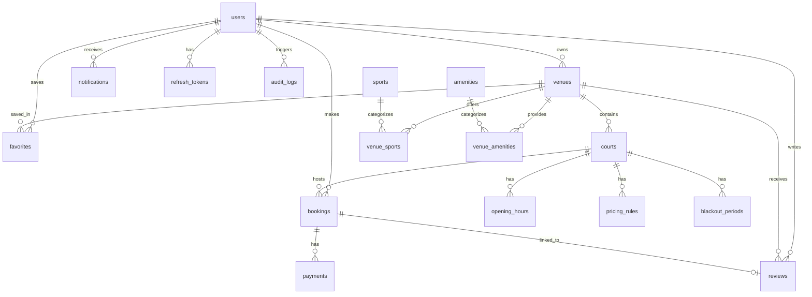

# 04 – Database Schema

> **Phiên bản:** 1.0.0 | **Cập nhật lần cuối:** 2026-09-30

## Quy ước chung

- **snake_case** cho tất cả tên bảng và cột.
- **Soft delete:** thêm cột `deleted_at TIMESTAMPTZ DEFAULT NULL`; query luôn filter `deleted_at IS NULL`.
- **Timestamps:** mọi bảng có `created_at TIMESTAMPTZ DEFAULT now()` và `updated_at TIMESTAMPTZ DEFAULT now()`.
- **UUID v7** làm primary key (sắp xếp theo thời gian, phù hợp index B-tree).
- **Múi giờ:** Lưu UTC (timestamptz/tstzrange), hiển thị Asia/Ho_Chi_Minh ở FE/API response.
- **Migration:** Mọi thay đổi schema qua file migration có version (`0001_init.sql`, `0002_...sql`). KHÔNG sửa tay.

## ERD Tổng quan



## Chi tiết bảng

### users
```sql
CREATE TABLE users (
  id          UUID PRIMARY KEY DEFAULT gen_random_uuid(),
  email       TEXT NOT NULL UNIQUE,
  password_hash TEXT,                    -- NULL nếu OAuth only
  full_name   TEXT NOT NULL,
  phone       TEXT,
  avatar_url  TEXT,
  role        TEXT NOT NULL CHECK (role IN ('customer','owner','admin')),
  status      TEXT NOT NULL DEFAULT 'active' CHECK (status IN ('active','suspended','pending')),
  created_at  TIMESTAMPTZ DEFAULT now(),
  updated_at  TIMESTAMPTZ DEFAULT now(),
  deleted_at  TIMESTAMPTZ
);
CREATE INDEX idx_users_email ON users(email) WHERE deleted_at IS NULL;
CREATE INDEX idx_users_role  ON users(role)  WHERE deleted_at IS NULL;
```

### oauth_accounts
```sql
CREATE TABLE oauth_accounts (
  id          UUID PRIMARY KEY DEFAULT gen_random_uuid(),
  user_id     UUID NOT NULL REFERENCES users(id) ON DELETE CASCADE,
  provider    TEXT NOT NULL CHECK (provider IN ('google')),
  provider_id TEXT NOT NULL,
  created_at  TIMESTAMPTZ DEFAULT now(),
  UNIQUE (provider, provider_id)
);
```

### refresh_tokens
```sql
CREATE TABLE refresh_tokens (
  id          UUID PRIMARY KEY DEFAULT gen_random_uuid(),
  user_id     UUID NOT NULL REFERENCES users(id) ON DELETE CASCADE,
  token_hash  TEXT NOT NULL UNIQUE,
  expires_at  TIMESTAMPTZ NOT NULL,
  revoked     BOOLEAN NOT NULL DEFAULT false,
  created_at  TIMESTAMPTZ DEFAULT now()
);
CREATE INDEX idx_rt_user ON refresh_tokens(user_id) WHERE revoked = false;
```

### sports
```sql
CREATE TABLE sports (
  id    UUID PRIMARY KEY DEFAULT gen_random_uuid(),
  name  TEXT NOT NULL UNIQUE,   -- "Bóng đá", "Cầu lông"
  slug  TEXT NOT NULL UNIQUE,   -- "bong-da", "cau-long"
  icon  TEXT,                   -- tên icon lucide
  sort_order INT DEFAULT 0,
  created_at TIMESTAMPTZ DEFAULT now(),
  updated_at TIMESTAMPTZ DEFAULT now()
);
```

### amenities
```sql
CREATE TABLE amenities (
  id    UUID PRIMARY KEY DEFAULT gen_random_uuid(),
  name  TEXT NOT NULL UNIQUE,   -- "Bãi đỗ xe", "Phòng thay đồ"
  slug  TEXT NOT NULL UNIQUE,
  icon  TEXT,
  sort_order INT DEFAULT 0,
  created_at TIMESTAMPTZ DEFAULT now(),
  updated_at TIMESTAMPTZ DEFAULT now()
);
```

### venues
```sql
CREATE TABLE venues (
  id           UUID PRIMARY KEY DEFAULT gen_random_uuid(),
  owner_id     UUID NOT NULL REFERENCES users(id),
  name         TEXT NOT NULL,
  slug         TEXT NOT NULL UNIQUE,
  description  TEXT,
  address      TEXT NOT NULL,
  district     TEXT NOT NULL,
  province     TEXT NOT NULL,
  lat          NUMERIC(10,7),
  lng          NUMERIC(10,7),
  status       TEXT NOT NULL DEFAULT 'pending'
                 CHECK (status IN ('pending','approved','rejected','suspended')),
  cover_url    TEXT,
  created_at   TIMESTAMPTZ DEFAULT now(),
  updated_at   TIMESTAMPTZ DEFAULT now(),
  deleted_at   TIMESTAMPTZ
);
CREATE INDEX idx_venues_owner   ON venues(owner_id) WHERE deleted_at IS NULL;
CREATE INDEX idx_venues_status  ON venues(status)   WHERE deleted_at IS NULL;
CREATE INDEX idx_venues_district ON venues(province, district) WHERE deleted_at IS NULL;
```

### venue_images
```sql
CREATE TABLE venue_images (
  id         UUID PRIMARY KEY DEFAULT gen_random_uuid(),
  venue_id   UUID NOT NULL REFERENCES venues(id) ON DELETE CASCADE,
  url        TEXT NOT NULL,
  sort_order INT DEFAULT 0,
  created_at TIMESTAMPTZ DEFAULT now()
);
```

### venue_sports / venue_amenities (junction)
```sql
CREATE TABLE venue_sports (
  venue_id  UUID REFERENCES venues(id) ON DELETE CASCADE,
  sport_id  UUID REFERENCES sports(id) ON DELETE CASCADE,
  PRIMARY KEY (venue_id, sport_id)
);

CREATE TABLE venue_amenities (
  venue_id    UUID REFERENCES venues(id) ON DELETE CASCADE,
  amenity_id  UUID REFERENCES amenities(id) ON DELETE CASCADE,
  PRIMARY KEY (venue_id, amenity_id)
);
```

### courts
```sql
CREATE TABLE courts (
  id          UUID PRIMARY KEY DEFAULT gen_random_uuid(),
  venue_id    UUID NOT NULL REFERENCES venues(id) ON DELETE CASCADE,
  name        TEXT NOT NULL,
  description TEXT,
  sport_id    UUID REFERENCES sports(id),
  status      TEXT NOT NULL DEFAULT 'active' CHECK (status IN ('active','inactive')),
  sort_order  INT DEFAULT 0,
  created_at  TIMESTAMPTZ DEFAULT now(),
  updated_at  TIMESTAMPTZ DEFAULT now(),
  deleted_at  TIMESTAMPTZ
);
CREATE INDEX idx_courts_venue ON courts(venue_id) WHERE deleted_at IS NULL;
```

### opening_hours
```sql
CREATE TABLE opening_hours (
  id         UUID PRIMARY KEY DEFAULT gen_random_uuid(),
  court_id   UUID NOT NULL REFERENCES courts(id) ON DELETE CASCADE,
  day_of_week SMALLINT NOT NULL CHECK (day_of_week BETWEEN 0 AND 6), -- 0=CN, 1=T2...
  open_time  TIME NOT NULL,
  close_time TIME NOT NULL,
  CHECK (open_time < close_time),
  UNIQUE (court_id, day_of_week)
);
```

### pricing_rules
```sql
CREATE TABLE pricing_rules (
  id            UUID PRIMARY KEY DEFAULT gen_random_uuid(),
  court_id      UUID NOT NULL REFERENCES courts(id) ON DELETE CASCADE,
  name          TEXT NOT NULL,
  price_per_slot INT NOT NULL,           -- VND per 30-min block
  start_time    TIME NOT NULL,
  end_time      TIME NOT NULL,
  day_of_week   SMALLINT[],             -- NULL = áp dụng mọi ngày
  date_override DATE,                   -- Ngày cụ thể (ngày lễ)
  priority      INT NOT NULL DEFAULT 0, -- Cao hơn = ưu tiên hơn
  created_at    TIMESTAMPTZ DEFAULT now(),
  updated_at    TIMESTAMPTZ DEFAULT now()
);
CREATE INDEX idx_pricing_court ON pricing_rules(court_id);
```

### blackout_periods
```sql
CREATE TABLE blackout_periods (
  id          UUID PRIMARY KEY DEFAULT gen_random_uuid(),
  court_id    UUID NOT NULL REFERENCES courts(id) ON DELETE CASCADE,
  reason      TEXT,
  during      TSTZRANGE NOT NULL,
  created_at  TIMESTAMPTZ DEFAULT now()
);
CREATE INDEX idx_blackout_court ON blackout_periods USING gist (court_id, during);
```

### bookings (bảng quan trọng nhất)
```sql
-- Extension bắt buộc
CREATE EXTENSION IF NOT EXISTS btree_gist;

CREATE TABLE bookings (
  id              UUID PRIMARY KEY DEFAULT gen_random_uuid(),
  court_id        UUID NOT NULL REFERENCES courts(id),
  customer_id     UUID NOT NULL REFERENCES users(id),
  during          TSTZRANGE NOT NULL,         -- UTC, ví dụ: [2026-10-15 08:00+07, 2026-10-15 09:30+07)
  status          TEXT NOT NULL DEFAULT 'held'
                    CHECK (status IN ('held','pending_payment','confirmed','completed','cancelled','expired','no_show')),
  total_price     INT NOT NULL,               -- VND, tính ở server
  note            TEXT,
  cancelled_by    UUID REFERENCES users(id),
  cancel_reason   TEXT,
  expires_at      TIMESTAMPTZ,               -- Chỉ dùng cho trạng thái held
  created_at      TIMESTAMPTZ DEFAULT now(),
  updated_at      TIMESTAMPTZ DEFAULT now(),

  -- CONSTRAINT QUAN TRỌNG: Chống trùng lịch
  -- Chỉ áp dụng cho held, pending_payment, confirmed (không áp dụng cho cancelled/expired/no_show/completed)
  EXCLUDE USING gist (
    court_id WITH =,
    during   WITH &&
  ) WHERE (status IN ('held', 'pending_payment', 'confirmed'))
);

CREATE INDEX idx_bookings_court_during ON bookings USING gist (court_id, during);
CREATE INDEX idx_bookings_customer     ON bookings(customer_id);
CREATE INDEX idx_bookings_status       ON bookings(status);
CREATE INDEX idx_bookings_expires      ON bookings(expires_at) WHERE status = 'held';
```

### payments
```sql
CREATE TABLE payments (
  id              UUID PRIMARY KEY DEFAULT gen_random_uuid(),
  booking_id      UUID NOT NULL REFERENCES bookings(id),
  amount          INT NOT NULL,
  provider        TEXT NOT NULL DEFAULT 'vietqr',
  provider_ref    TEXT,                        -- Mã giao dịch của provider
  status          TEXT NOT NULL DEFAULT 'pending'
                    CHECK (status IN ('pending','completed','failed','refunded')),
  idempotency_key TEXT NOT NULL UNIQUE,        -- Tránh xử lý webhook 2 lần
  paid_at         TIMESTAMPTZ,
  created_at      TIMESTAMPTZ DEFAULT now(),
  updated_at      TIMESTAMPTZ DEFAULT now()
);
```

### reviews
```sql
CREATE TABLE reviews (
  id          UUID PRIMARY KEY DEFAULT gen_random_uuid(),
  booking_id  UUID NOT NULL UNIQUE REFERENCES bookings(id),
  venue_id    UUID NOT NULL REFERENCES venues(id),
  customer_id UUID NOT NULL REFERENCES users(id),
  rating      SMALLINT NOT NULL CHECK (rating BETWEEN 1 AND 5),
  content     TEXT,
  is_visible  BOOLEAN NOT NULL DEFAULT true,
  created_at  TIMESTAMPTZ DEFAULT now(),
  updated_at  TIMESTAMPTZ DEFAULT now()
);
CREATE INDEX idx_reviews_venue ON reviews(venue_id) WHERE is_visible = true;
```

### favorites
```sql
CREATE TABLE favorites (
  user_id    UUID REFERENCES users(id) ON DELETE CASCADE,
  venue_id   UUID REFERENCES venues(id) ON DELETE CASCADE,
  created_at TIMESTAMPTZ DEFAULT now(),
  PRIMARY KEY (user_id, venue_id)
);
```

### notifications
```sql
CREATE TABLE notifications (
  id          UUID PRIMARY KEY DEFAULT gen_random_uuid(),
  user_id     UUID NOT NULL REFERENCES users(id) ON DELETE CASCADE,
  type        TEXT NOT NULL,             -- "booking_confirmed", "booking_cancelled", ...
  title       TEXT NOT NULL,
  body        TEXT NOT NULL,
  data        JSONB,
  read_at     TIMESTAMPTZ,
  created_at  TIMESTAMPTZ DEFAULT now()
);
CREATE INDEX idx_notif_user_unread ON notifications(user_id) WHERE read_at IS NULL;
```

### audit_logs
```sql
CREATE TABLE audit_logs (
  id          UUID PRIMARY KEY DEFAULT gen_random_uuid(),
  actor_id    UUID REFERENCES users(id),
  action      TEXT NOT NULL,             -- "venue.approved", "user.suspended"
  entity_type TEXT NOT NULL,
  entity_id   UUID,
  old_data    JSONB,
  new_data    JSONB,
  ip_address  INET,
  created_at  TIMESTAMPTZ DEFAULT now()
);
CREATE INDEX idx_audit_entity ON audit_logs(entity_type, entity_id);
CREATE INDEX idx_audit_actor  ON audit_logs(actor_id);
```

## Quy tắc migration

1. **Đặt tên file:** `NNNN_mô-tả-ngắn.sql` (vd: `0001_init-schema.sql`, `0002_add-blackout-periods.sql`).
2. **Mỗi migration là idempotent hoặc có rollback script tương ứng.**
3. **KHÔNG** sửa trực tiếp file migration đã được merge vào main.
4. **Constraint EXCLUDE** phải được viết trong file SQL migration tùy chỉnh (Drizzle chưa hỗ trợ native).
5. Chạy lệnh: `pnpm --filter @bsc/api db:migrate`
