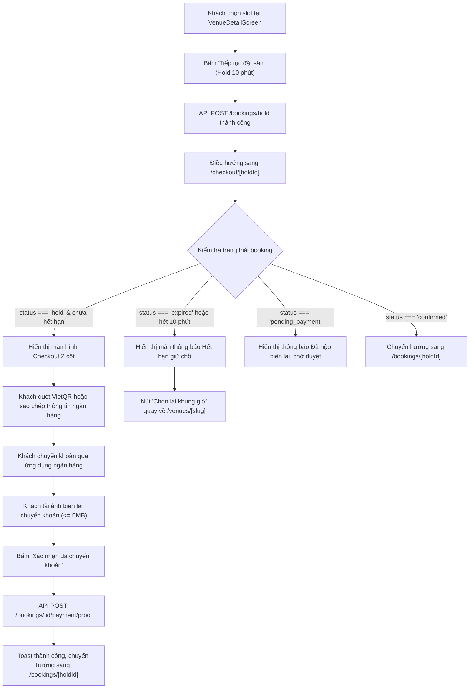

# ĐẶC TẢ KỸ THUẬT: HOÀN THIỆN FRONTEND BATCH 4 (TRANG CHECKOUT ĐỘC LẬP + SO SÁNH CƠ SỞ THỂ THAO GST-04)

- **Mã tài liệu:** `SPEC-FE-BATCH4-01`
- **Tác giả:** Product Architect & UX Specifier (`ba-spec` – 9router_BA)
- **Dự án:** BookSportsCourt (Sàn thương mại điện tử đặt sân thể thao đa người dùng)
- **Nền tảng mục tiêu:** Web Client (`apps/web` – Next.js 14 App Router, TypeScript, Tailwind CSS, TanStack Query, Next-Intl, Lucide, Sonner)
- **Trạng thái:** Approved / Sẵn sàng bàn giao cho `senior-dev` (9router_DEV)
- **Tham chiếu:**
  - `AGENTS.md` (10 quy tắc tối thượng)
  - `G:\Slides_BaiGiangTLU\ChuyenDeCNTT\danh-sach-cong-viec-hoan-thien-frontend.md` (TODO-14, TODO-15)
  - `docs/02-features-by-role.md` (GST-04 so sánh cơ sở thể thao, CUS-08 giữ chỗ 10 phút, CUS-09 thanh toán QR)
  - `docs/05-booking-and-realtime.md` (Vòng đời booking, hold 10 phút, checkout VietQR)
  - `docs/07-design-system.md` & `docs/08-ui-quality-rules.md` (Anti-AI Design & Color Tokens)
  - `docs/09-frontend-conventions.md` & `docs/11-api-contract.md` (Next.js 14 App Router standards)

---

## 1. Tổng quan & Mục tiêu Kỹ thuật BATCH 4

Batch 4 hoàn thiện 2 tính năng mở rộng quan trọng trong lộ trình hoàn thiện Frontend, hoàn tất 100% danh mục tính năng của đồ án:

| STT | Mã việc | Tên việc cần làm | Mức độ | Phạm vi giải quyết |
|:---:|:---|:---|:---:|:---|
| 1 | **TODO-14** | Tách route thanh toán Checkout độc lập `/checkout/[holdId]` | **P2** | Xây dựng route Next.js `apps/web/app/(customer)/checkout/[holdId]/page.tsx` và màn hình `CheckoutScreen.tsx`. Cho phép khách hàng có một URL checkout chuyên biệt, tập trung vào hoàn tất chuyển khoản và gửi minh chứng thanh toán VietQR trong 10 phút giữ chỗ. Đồng bộ bảo vệ route trong `middleware.ts` và cập nhật điều hướng từ `VenueDetailScreen.tsx`. Vẫn duy trì `PaymentPanel.tsx` tại `/bookings/[id]` làm phương án dự phòng. |
| 2 | **TODO-15** | Tính năng so sánh cơ sở thể thao (GST-04) | **P2** | Xây dựng cơ chế so sánh tối đa 3 cơ sở thể thao cho cả Khách vãng lai (Guest) và Khách hàng (Customer). Tạo hook `useVenueComparison` lưu trữ `localStorage` (`bsc_compare_venues_v1`). Xây dựng thanh công cụ nổi cố định đáy màn hình `VenueCompareFloatingBar.tsx`. Bổ sung nút so sánh trên `VenueCard.tsx` và `VenueDetailScreen.tsx`. Xây dựng trang so sánh công khai `apps/web/app/(public)/venues/compare/page.tsx` và màn hình ma trận `VenueCompareScreen.tsx`. |

---

## 2. Tiêu chuẩn Thiết kế Anti-AI (Strict Anti-AI Rules)

Tuân thủ nghiêm ngặt theo `docs/07-design-system.md`, `docs/08-ui-quality-rules.md` và `AGENTS.md`:

| Tiêu chí | ❌ HÀNH VI CẤM (AI Slop / Cliche) | ✅ CHUẨN THIẾT KẾ DỰ ÁN (Linear / Stripe Standard) |
|---|---|---|
| **Màu sắc & Gradient** | CẤM gradient tím/hồng/xanh neon (`from-purple-500 to-pink-500`), cấm hiệu ứng glassmorphism mờ đục lòe loẹt. | 100% màu sắc lấy từ CSS tokens: Nền trắng `#ffffff` (light) / slate cực tối `#090d16` (dark), viền mỏng 1px `#e2e8f0` (light) / `#334155` (dark), text chính `#0f172a` (light) / `#f8fafc` (dark), thương hiệu xanh sân cỏ `#15803d` / `#16a34a`. |
| **Bo góc (Border Radius)** | CẤM bo góc dị dạng `rounded-3xl` cho card hoặc modal. CẤM bo tròn toàn bộ nút bấm `rounded-full` một cách tùy tiện. | Button / Input: `rounded-btn` (8px). Card / Panel: `rounded-card` (12px). Dialog: `rounded-xl` (12px). Badge: `rounded-md` (6px) hoặc `rounded-full` cho badge trạng thái nhỏ. |
| **Biểu tượng (Icons)** | CẤM chèn emoji rác (💳, ⚖️, 🚀, ✨, ⏰, 🔍, ⚽) vào nút bấm, tiêu đề hoặc văn bản UI. | 100% biểu tượng dùng `lucide-react` cố định kích thước (`size-4`, `size-5`), nét stroke 1.5px (`ArrowLeftRight`, `Copy`, `Check`, `Timer`, `Upload`, `ImagePlus`, `Trash2`, `ExternalLink`, `ShieldCheck`, `CheckCircle2`, `XCircle`). |
| **Hộp thoại tương tác** | CẤM dùng `window.alert()`, `window.confirm()`. CẤM popup sập trang kiểu modal toàn màn hình giật cục. | Sử dụng `<ErrorState>` chuẩn, `<EmptyState>` chuẩn, hoặc `<Dialog>` Radix UI accessible. Toast thông báo thanh lịch từ `sonner`. |
| **Trạng thái Component** | Thiếu các trạng thái tương tác hoặc chỉ xoay vòng spinner vô hạn. | Đủ 6 trạng thái bắt buộc: `Default`, `Hover`, `Focus-visible` (ring outline 2px), `Loading` (skeleton/spinner), `Disabled` (opacity 50%, cursor-not-allowed), `Empty` / `Error`. |
| **Thanh nổi Floating Bar** | CẤM che khuất nội dung quan trọng ở footer hoặc nhảy giật layout. | Thanh nổi ghim cố định đáy (`fixed bottom-0 inset-x-0 z-40`), có đệm padding dưới cho các trang (`pb-24`), hiệu ứng trượt nhẹ nhàng `transition-transform duration-200`. |

---

## 3. Đặc tả Kỹ thuật TODO-14: Trang Checkout Độc Lập `/checkout/[holdId]`

### 3.1. Hiện trạng & Lý do Tách Route
- **Hiện tại:** Sau khi chọn khung giờ trên `VenueDetailScreen`, hàm `useCreateHold()` trả về `{ booking, payment }`. Màn hình hiện gọi `router.push('/bookings/' + result.booking.id)`. Trang `/bookings/[id]` hiển thị đồng thời cả `PaymentPanel` lẫn các chức năng quản lý booking dài hạn (như nút Huỷ đặt sân, thông tin khách, chính sách huỷ, form đánh giá...).
- **Vấn đề:** 
  1. Người dùng bị phân tâm bởi các thông tin không liên quan trong thời gian 10 phút khẩn cấp cần hoàn tất chuyển khoản VietQR.
  2. Thiếu trải nghiệm luồng thanh toán (Checkout Funnel) chuẩn thương mại điện tử như Stripe/Airbnb.
  3. Khi người dùng muốn copy link thanh toán để chuyển sang điện thoại hoặc gửi cho người thanh toán hộ, URL `/checkout/[holdId]` thể hiện rõ ngữ cảnh thanh toán giữ chỗ tạm thời hơn là `/bookings/[id]`.

### 3.2. Cấu trúc Tệp tin (File Architecture)
```
apps/web/
├── app/
│   └── (customer)/
│       └── checkout/
│           └── [holdId]/
│               ├── loading.tsx               # Skeleton loading cho trang checkout
│               └── page.tsx                  # Server component wrapper & metadata
├── components/
│   └── features/
│       └── checkout/
│           ├── CheckoutScreen.tsx            # Client component chính xử lý luồng checkout
│           ├── CheckoutSummary.tsx           # Tóm tắt thông tin sân, khung giờ, bảng tính cọc
│           ├── CheckoutPaymentSection.tsx    # Mã VietQR, thông tin TK ngân hàng, copy buttons
│           └── CheckoutProofUploader.tsx     # Tải ảnh minh chứng chuyển khoản & xác nhận
├── middleware.ts                             # Bổ sung bảo vệ route /checkout
└── messages/
    └── vi.json                               # Bổ sung namespace "checkout"
```

### 3.3. Luồng Nghiệp vụ Chi tiết (Checkout User Flow)



### 3.4. Chi tiết Component & Giao diện

#### 3.4.1. `app/(customer)/checkout/[holdId]/page.tsx`
- **Loại:** Server Component.
- **Quyền hạn:** Yêu cầu đăng nhập (`Customer` hoặc `Owner`/`Admin`).
- **Metadata:**
  ```typescript
  export const metadata: Metadata = {
    title: 'Thanh toán giữ chỗ | BookSportsCourt',
    description: 'Hoàn tất chuyển khoản tiền cọc để xác nhận đặt sân thể thao trong thời gian giữ chỗ.',
  };
  ```
- **Nội dung:** Render `<CheckoutScreen />`.

#### 3.4.2. `middleware.ts`
- Cập nhật dòng kiểm tra `isCustomerRoute`:
  ```typescript
  const isCustomerRoute =
    pathname.startsWith('/bookings') ||
    pathname.startsWith('/checkout') ||
    pathname.startsWith('/favorites') ||
    pathname.startsWith('/profile') ||
    pathname.startsWith('/notifications');
  ```
- Nếu khách chưa đăng nhập truy cập `/checkout/[holdId]`, tự động redirect về `/login?next=/checkout/[holdId]`.

#### 3.4.3. `components/features/checkout/CheckoutScreen.tsx`
- **Hooks tích hợp:**
  1. `const { holdId } = useParams<{ holdId: string }>();`
  2. `const bookingQuery = useBookingDetail(holdId);` (lấy `BookingDetail` đầy đủ thông tin cơ sở, sân, giờ, tiền cọc).
  3. `const holdQuery = useHoldInfo(holdId, bookingQuery.data?.status === 'held');` (lấy thông tin thanh toán ngân hàng VietQR + đếm ngược định kỳ 10s).
  4. `const upload = useUploadProof(holdId);` (gửi ảnh minh chứng).
  5. `const router = useAppRouter();`
- **Trạng thái tải (Loading):** Render `CheckoutSkeleton` gồm thanh tiến trình, 2 cột card với hiệu ứng skeleton thanh lịch.
- **Trạng thái Lỗi / Không tìm thấy:** Khi `bookingQuery.isError` hoặc không có dữ liệu, hiển thị `<ErrorState>` với nút "Thử lại" và nút "Về trang chủ".
- **Bố cục 2 cột (Desktop Grid `lg:grid-cols-12`):**
  - **Cột Trái (`lg:col-span-5` / `lg:col-span-6`): Tóm tắt đơn giữ chỗ (`CheckoutSummary.tsx`)**
    * Breadcrumb: `Trang chủ / Tìm sân / <Tên cơ sở> / Thanh toán giữ chỗ`.
    * Card tóm tắt:
      - Tên cơ sở thể thao (bold, heading-2).
      - Địa chỉ cơ sở (icon `MapPin`).
      - Tên sân con (ví dụ: "Sân 1 (Sân 5 người)").
      - Ngày thi đấu: `formatDateWithWeekday(booking.during.start)` (ví dụ: "Thứ Bảy, 15/10/2026").
      - Khung giờ thi đấu: `formatTimeRange(start, end)` kèm số lượng block 30 phút.
      - Phân tích chi phí:
        * Tổng tiền thuê sân: `formatCurrency(booking.totalPrice)`.
        * Số tiền cọc cần chuyển ngay: `formatCurrency(booking.depositAmount)` (highlight màu xanh lá đậm `text-primary-700 font-bold text-lg`).
        * Số tiền còn lại thanh toán tại sân: `formatCurrency(booking.totalPrice - booking.depositAmount)` (ghi chú: "Thanh toán cho chủ sân khi nhận sân").
      - Chính sách huỷ & hoàn cọc: Box nền trung tính `bg-neutral-50 dark:bg-neutral-900 border border-neutral-200 dark:border-neutral-800 rounded-btn p-3 text-xs text-neutral-600 dark:text-neutral-400`.
  - **Cột Phải (`lg:col-span-7` / `lg:col-span-6`): Khu vực thanh toán VietQR & Gửi minh chứng**
    * **Đồng hồ đếm ngược `HoldCountdown`:**
      - Đặt ở vị trí trên cùng của cột phải, làm nổi bật thời gian 10 phút còn lại.
      - Nếu thời gian dưới 2 phút: đổi sang màu cảnh báo hổ phách (`bg-amber-50 text-amber-800 border-amber-300`).
      - Khi hết giờ: gọi callback kích hoạt giao diện hết hạn.
    * **Khối Mã QR VietQR (`CheckoutPaymentSection.tsx`):**
      - Tự động sinh mã VietQR phía client bằng `buildTransferQrPayload` kết hợp thư viện `qrcode`.
      - Khung QR màu trắng viền 1px, kích thước chuẩn 240x240px, ở giữa có logo nhận diện nếu có.
      - Dưới mã QR: Ghi chú "Mở ứng dụng ngân hàng bất kỳ để quét mã VietQR tự động điền số tiền và nội dung".
    * **Khối Thông tin Chuyển khoản (Dự phòng quét mã):**
      - Bảng thông tin rõ ràng với nút Copy nhanh từng dòng (kèm toast thông báo "Đã sao chép"):
        1. **Ngân hàng thụ hưởng:** Tên ngân hàng thương mại (tra từ `bankBin` qua `bankNameFromBin`).
        2. **Số tài khoản:** Mã số tài khoản ngân hàng (Font mono, nút sao chép).
        3. **Chủ tài khoản:** Tên chủ tài khoản viết hoa không dấu.
        4. **Số tiền chuyển khoản:** Chính xác `booking.depositAmount` (Font bold, nút sao chép).
        5. **Nội dung chuyển khoản (BẮT BUỘC):** `transferCode` chuẩn (ví dụ `BSC-A1B2C3`, Font mono, highlight hổ phách, nút sao chép, cảnh báo: "Vui lòng giữ nguyên nội dung chuyển khoản để đơn được duyệt tự động/nhanh nhất").
    * **Khối Tải Minh chứng Thanh toán (`CheckoutProofUploader.tsx`):**
      - Tiêu đề: "Xác nhận đã chuyển khoản".
      - Input file ẩn (`accept="image/png,image/jpeg,image/webp"`), nút chọn file icon `ImagePlus`.
      - Kiểm tra kích thước file: Tối đa 5MB (`MAX_PROOF_BYTES = 5 * 1024 * 1024`), hiển thị lỗi inline nếu file quá lớn hoặc sai định dạng ảnh.
      - Khu vực preview ảnh đã chọn (kèm nút xem lại / chọn ảnh khác / xóa ảnh).
      - Nút CTA chính: **"Xác nhận đã chuyển khoản"** (icon `Upload`, variant `primary`, full-width trên mobile, trạng thái loading khi đang upload).
      - Khi upload thành công: Bắn toast "Đã gửi minh chứng thanh toán thành công", điều hướng sau 1.5 giây sang `/bookings/[holdId]`.

#### 3.4.4. Xử lý Trạng thái Ngoại lệ (Edge Cases)
1. **Đơn giữ chỗ đã hết hạn (`booking.status === 'expired'` hoặc countdown = 0):**
   - Không cho phép upload ảnh hay xác nhận thanh toán.
   - Hiển thị card thông báo hết hạn với icon `Timer` hoặc `AlertCircle` màu đỏ/cam.
   - Tiêu đề: "Thời gian giữ chỗ đã kết thúc".
   - Mô tả: "Khung giờ bạn chọn đã tự động được trả lại trạng thái trống cho các khách hàng khác. Vui lòng quay lại để chọn khung giờ mới."
   - 2 nút hành động:
     * "Chọn lại khung giờ": Điều hướng về `/venues/[venueSlug]`.
     * "Tìm sân khác": Điều hướng về `/venues`.
2. **Đơn đã ở trạng thái `pending_payment`:**
   - Trường hợp khách đã nộp ảnh biên lai trên tab khác hoặc tải lại trang:
   - Hiển thị thông báo: "Đơn đặt sân đang chờ chủ sân duyệt thanh toán." kèm nút "Xem chi tiết đơn" trỏ sang `/bookings/[holdId]`.
3. **Đơn đã ở trạng thái `confirmed`:**
   - Tự động chuyển hướng ngay sang `/bookings/[holdId]`.

#### 3.4.5. Cập nhật `VenueDetailScreen.tsx`
- Tìm đến hàm `onContinue`:
  ```typescript
  const result = await hold.mutateAsync({
    courtId,
    slots,
    idempotencyKey: idempotencyKey.current,
  });
  // Thay thế đường dẫn cũ:
  // router.push(`/bookings/${result.booking.id}`);
  // Bằng đường dẫn sang checkout:
  router.push(`/checkout/${result.booking.id}`);
  ```
- Tại `BookingDetailScreen.tsx`, nếu đơn đang ở trạng thái `held`, bên cạnh `PaymentPanel` inline hiện tại, bổ sung nút liên kết phụ: *"Mở trang thanh toán riêng"* trỏ đến `/checkout/${booking.id}`.

---

## 4. Đặc tả Kỹ thuật TODO-15: Tính năng So sánh Cơ sở Thể thao (GST-04)

### 4.1. Bối cảnh & Yêu cầu Nghiệp vụ
- Theo đặc tả **GST-04** trong `docs/02-features-by-role.md`: Cả Khách vãng lai (Guest - chưa đăng nhập) và Khách hàng (Customer - đã đăng nhập) đều có nhu cầu so sánh trực quan giữa các cơ sở thể thao để đưa ra quyết định đặt sân tốt nhất (về giá, mặt sân, tiện ích, vị trí, giờ mở cửa, chất lượng đánh giá).
- Giới hạn: **Tối đa 3 cơ sở** cùng lúc (chuẩn UX so sánh trang lớn, tránh vỡ cột trên màn hình vừa và nhỏ).

### 4.2. Cấu trúc Tệp tin (File Architecture)
```
apps/web/
├── app/
│   └── (public)/
│       └── venues/
│           └── compare/
│               ├── loading.tsx               # Skeleton loading trang so sánh
│               └── page.tsx                  # Server component wrapper & metadata
├── components/
│   └── features/
│       └── venue/
│           ├── VenueCompareFloatingBar.tsx   # Thanh nổi đáy màn hình khi có sân được chọn
│           ├── VenueCompareScreen.tsx        # Màn hình bảng so sánh chi tiết dạng cột
│           ├── VenueCompareCard.tsx          # Card cơ sở trong bảng so sánh
│           ├── VenueCompareButton.tsx        # Nút bật/tắt so sánh dùng chung
│           └── VenueCard.tsx                 # Tích hợp nút so sánh
├── lib/
│   └── hooks/
│       └── useVenueComparison.ts             # Hook & Store quản lý danh sách so sánh
└── messages/
    └── vi.json                               # Bổ sung namespace "compare"
```

### 4.3. Đặc tả Hook Quản lý So sánh `apps/web/lib/hooks/useVenueComparison.ts`

- **Key lưu trữ LocalStorage:** `bsc_compare_venues_v1`
- **Hằng số giới hạn:** `MAX_COMPARE_VENUES = 3`
- **Interface Dữ liệu:**
  ```typescript
  export interface CompareVenueItem {
    id: string;
    name: string;
    slug: string;
    address: string;
    provinceName?: string;
    districtName?: string;
    lat: number;
    lng: number;
    coverUrl: string | null;
    ratingAvg: number;
    reviewCount: number;
    fromPrice: number;
    sports: Array<{ id: string; name: string; slug: string }>;
  }
  ```
- **Hàm chức năng trong hook:**
  1. `venues: CompareVenueItem[]`: Danh sách cơ sở hiện tại (tối đa 3).
  2. `count: number`: Số lượng cơ sở đã chọn (`0..3`).
  3. `isInComparison(venueId: string): boolean`: Kiểm tra một cơ sở đã nằm trong danh sách hay chưa.
  4. `addVenue(venue: VenueListItem | VenueDetail): boolean`:
     - Nếu đã tồn tại: bỏ qua và trả về `true`.
     - Nếu danh sách đã đạt `MAX_COMPARE_VENUES` (3 cơ sở): Bắn `toast.warning('Bạn chỉ có thể so sánh tối đa 3 cơ sở cùng lúc. Vui lòng bỏ bớt cơ sở trước khi thêm mới.')` và trả về `false`.
     - Nếu hợp lệ: Thêm vào mảng, cập nhật `localStorage`, phát sự kiện tùy biến `bsc:compare-updated` để đồng bộ giữa các component, bắn `toast.success('Đã thêm "' + venue.name + '" vào danh sách so sánh')`, trả về `true`.
  5. `removeVenue(venueId: string): void`:
     - Xóa cơ sở khỏi danh sách theo `id`, cập nhật `localStorage`, phát sự kiện `bsc:compare-updated`, bắn `toast.info('Đã xóa cơ sở khỏi danh sách so sánh')`.
  6. `clearVenues(): void`:
     - Xóa toàn bộ danh sách, cập nhật `localStorage`, phát sự kiện.
  7. `canCompare: boolean`: `true` khi `count >= 2`.

### 4.4. Đặc tả Component `VenueCompareFloatingBar.tsx`

- **Vị trí hiển thị:** Cố định ở đáy màn hình (`fixed bottom-0 inset-x-0 z-40`).
- **Điều kiện hiển thị:**
  - `count > 0`.
  - Không hiển thị trên chính trang `/venues/compare` (để tránh lặp UI).
- **Thiết kế Anti-AI (Linear / Stripe Standard):**
  - Khung nền: Nền trắng với độ đục cao hoặc dark slate (`bg-white/95 dark:bg-neutral-900/95 backdrop-blur-md border-t border-neutral-200 dark:border-neutral-800 shadow-[0_-4px_16px_rgba(0,0,0,0.06)]`).
  - Container căn giữa: `container flex flex-wrap items-center justify-between gap-3 py-3`.
  - **Khu vực Trái:**
    * Tiêu đề: "So sánh cơ sở" + Badge đếm số lượng: `rounded-full bg-primary-50 dark:bg-primary-950/50 text-primary-700 dark:text-primary-300 px-2 py-0.5 text-xs font-semibold`.
    * Danh sách thumbnail các cơ sở đã chọn:
      - Tối đa 3 slot:
        * Slot đã chọn: Hình ảnh thu nhỏ (`size-10 rounded-md object-cover border border-neutral-200 dark:border-neutral-800`), tên cơ sở (`text-xs font-medium line-clamp-1 max-w-[100px] sm:max-w-[140px]`), nút xoá nhỏ góc trên thumbnail (icon `X` kích thước `size-3.5` hover chuyển sang đỏ).
        * Slot còn trống: Ô viền nét đứt (`border-dashed border-neutral-300 dark:border-neutral-700 size-10 rounded-md flex items-center justify-center text-neutral-400 text-xs`) ghi "+".
  - **Khu vực Phải:**
    * Nút "Xóa tất cả": Variant `ghost`, kích thước `sm`, icon `Trash2`, text-neutral-500.
    * Nút "So sánh ngay":
      - Variant `primary`, kích thước `sm`, icon `ArrowLeftRight`.
      - Nhãn: `So sánh ngay (${count}/3)`.
      - Trạng thái Disabled: Khi `count < 2` (kèm hint nhỏ hoặc tooltip "Chọn ít nhất 2 cơ sở để so sánh").
      - Khi bấm: Điều hướng sang `/venues/compare`.

### 4.5. Tích hợp Nút So sánh trên `VenueCard.tsx` và `VenueDetailScreen.tsx`

#### 4.5.1. Trên `VenueCard.tsx`
- Bổ sung component nút `VenueCompareButton` hoặc nhúng trực tiếp:
- Vị trí: Đặt ở góc trên ảnh (cùng hàng hoặc cạnh badge trạng thái/yêu thích) hoặc đặt tại chân thẻ.
- **Trạng thái:**
  - *Chưa chọn:* Nút viền mỏng mờ, nền trắng/slate mờ (`bg-white/80 dark:bg-neutral-900/80 hover:bg-white dark:hover:bg-neutral-800 text-neutral-600 dark:text-neutral-300 p-1.5 rounded-btn border border-neutral-200 dark:border-neutral-700`).
  - *Đã chọn:* Nền xanh lá nhạt (`bg-primary-50 dark:bg-primary-950/60 text-primary-700 dark:text-primary-300 border-primary-300 dark:border-primary-700 font-semibold`).
- Thao tác: Bấm nút gọi `addVenue` hoặc `removeVenue` (có chặn `e.preventDefault()` và `e.stopPropagation()` để không kích hoạt click thẻ `<Link>`).

#### 4.5.2. Trên `VenueDetailScreen.tsx`
- Bổ sung nút "So sánh" trên thanh công cụ tiêu đề cạnh nút Yêu thích hoặc Chia sẻ.
- Icon `ArrowLeftRight`, hiển thị trạng thái đã chọn hay chưa chọn, bấm vào để toggle.

### 4.6. Đặc tả Trang So sánh `/venues/compare` & `VenueCompareScreen.tsx`

#### 4.6.1. Route `apps/web/app/(public)/venues/compare/page.tsx`
- **Loại:** Server Component, route công khai không yêu cầu đăng nhập.
- **Metadata:**
  ```typescript
  export const metadata: Metadata = {
    title: 'So sánh cơ sở thể thao | BookSportsCourt',
    description: 'So sánh trực quan về giá, môn thể thao, tiện ích và đánh giá giữa các cơ sở thể thao hàng đầu.',
  };
  ```
- **Nội dung:** Render `<VenueCompareScreen />`.

#### 4.6.2. Màn hình `VenueCompareScreen.tsx`
- **Các trạng thái hiển thị:**
  1. **Trạng thái Rỗng (`count === 0`):**
     - Render `<EmptyState>` chuẩn:
       * Icon: `ArrowLeftRight` (`size-12 text-neutral-400`).
       * Tiêu đề: "Chưa có cơ sở nào trong danh sách so sánh".
       * Mô tả: "Hãy duyệt danh sách sân thể thao và bấm nút 'So sánh' trên các cơ sở bạn quan tâm (tối đa 3 cơ sở) để xem đối chiếu chi tiết."
       * Nút hành động: Button variant `primary` "Khám phá danh sách sân" trỏ về `/venues`.
  2. **Trạng thái Chưa đủ điều kiện (`count === 1`):**
     - Hiển thị banner hổ phách: "Bạn đã chọn 1 cơ sở. Vui lòng chọn thêm ít nhất 1 cơ sở nữa để tiến hành so sánh."
     - Hiển thị card của cơ sở hiện tại kèm 1 ô trống lớn có nút bấm "+ Chọn thêm cơ sở từ danh sách" dẫn về `/venues`.
  3. **Trạng thái So sánh Hợp lệ (`count === 2` hoặc `count === 3`):**
     - Thanh tiêu đề trang:
       * Tiêu đề: "So sánh cơ sở thể thao" (`text-2xl font-bold`).
       * Mô tả: "Đối chiếu các thông số quan trọng giữa các cơ sở bạn đã chọn."
       * Nút "Xóa tất cả" (icon `Trash2`).
       * Nút "+ Thêm cơ sở khác" (nếu mới có 2 cơ sở, dẫn về `/venues`).
     - **Bảng ma trận đối chiếu (Comparison Matrix):**
       - Bố cục: Bảng dạng lưới cột chuẩn Desktop & cuộn ngang mượt mà trên Mobile (`overflow-x-auto`).
       - Cột 1 (Cố định nhãn thông số - Sticky Label Column): Độ rộng cố định (`w-40 sm:w-56`), nền trung tính, phân cách viền mỏng.
       - Cột 2, 3, 4 (Các cơ sở được so sánh): Mỗi cơ sở 1 cột độc lập (`min-w-[260px] sm:min-w-[300px] flex-1`).

#### 4.6.3. Chi tiết các Tiêu chí So sánh trong Ma trận
| Nhóm tiêu chí | Thông số hiển thị | Quy cách thể hiện (Anti-AI) |
|---|---|---|
| **Cơ sở (Header)** | Ảnh đại diện, Tên cơ sở, Nút xóa khỏi so sánh (`X`), Nút CTA **"Đặt sân ngay"** | Ảnh tỉ lệ 16:9, nút CTA variant `primary` kích thước đầy đủ dẫn thẳng tới `/venues/[slug]`. |
| **Môn thể thao** | Danh sách môn thể thao hỗ trợ | Danh sách các pill badge (`rounded-full bg-neutral-100 dark:bg-neutral-800 text-xs text-neutral-700 dark:text-neutral-300 px-2 py-0.5`). |
| **Bảng giá thuê** | Mức giá khởi điểm ("Từ X đ/slot 30p") | Định dạng tiền VND rõ ràng (`formatCurrency(venue.fromPrice)`). Tô đậm nổi bật cơ sở có mức giá rẻ nhất bằng badge "Giá tốt nhất" màu xanh lá. |
| **Đánh giá & Uy tín** | Điểm số đánh giá trung bình & Số lượt review | Số sao trung bình (1-5 sao, icon `Star` vàng rực `size-4 fill-amber-400 text-amber-400`) + Tổng số lượt đánh giá (`reviewCount`). Nếu 0 review: hiện "Chưa có đánh giá". |
| **Địa điểm & Khu vực** | Tỉnh/Thành phố, Quận/Huyện, Địa chỉ chi tiết | Icon `MapPin`, hiển thị tên Quận/Huyện, Tỉnh/Thành phố và địa chỉ đầy đủ. |
| **Tiện ích cơ sở** | Wifi, Chỗ đỗ xe máy/ô tô, Nước uống, Đèn đêm, Phòng thay đồ... | Nếu fetch thêm chi tiết hoặc từ dữ liệu có sẵn: Checkmark xanh (`CheckCircle2 text-primary-600`) cho tiện ích có sẵn, gạch xám (`XCircle text-neutral-300`) cho tiện ích không có. |
| **Hành động cuối** | Nút CTA đặt sân & Nút xem trên bản đồ | Nút phụ "Xem chi tiết" (variant `outline`) và "Đặt sân ngay" (variant `primary`). |

---

## 5. Từ điển Đa ngôn ngữ (i18n Translation Matrix)

Cập nhật tệp tin `apps/web/messages/vi.json` với 2 namespace mới `checkout` và `compare`:

```json
{
  "checkout": {
    "title": "Thanh toán giữ chỗ",
    "subtitle": "Hoàn tất chuyển khoản tiền cọc để xác nhận đặt sân thể thao trong thời gian giữ chỗ.",
    "breadcrumb": "Thanh toán giữ chỗ",
    "orderSummary": "Tóm tắt đơn giữ chỗ",
    "venue": "Cơ sở thể thao",
    "court": "Sân",
    "matchDate": "Ngày chơi",
    "matchTime": "Khung giờ",
    "totalPrice": "Tổng giá trị đơn",
    "depositRequired": "Số tiền cọc cần chuyển ngay",
    "remainingAtVenue": "Còn lại thanh toán tại sân",
    "cancellationPolicyTitle": "Chính sách huỷ & hoàn cọc",
    "countdownLabel": "Thời gian giữ chỗ còn lại",
    "urgentWarning": "Sắp hết thời gian giữ chỗ! Vui lòng hoàn tất thanh toán.",
    "scanQrHint": "Mở ứng dụng ngân hàng bất kỳ để quét mã VietQR tự động điền số tiền và nội dung.",
    "transferInfoTitle": "Thông tin chuyển khoản ngân hàng",
    "bankName": "Ngân hàng thụ hưởng",
    "accountNo": "Số tài khoản",
    "accountName": "Chủ tài khoản",
    "amount": "Số tiền chuyển",
    "transferCode": "Nội dung chuyển khoản",
    "transferCodeWarning": "BẮT BUỘC ghi đúng nội dung này để hệ thống đối soát tự động.",
    "copy": "Sao chép",
    "copied": "Đã sao chép vào bộ nhớ tạm",
    "uploadProofTitle": "Xác nhận đã chuyển khoản",
    "uploadProofHint": "Tải ảnh chụp màn hình giao dịch chuyển khoản thành công. Tối đa 5MB (JPG, PNG, WebP).",
    "chooseImage": "Chọn ảnh biên lai",
    "changeImage": "Chọn ảnh khác",
    "confirmPayment": "Xác nhận đã chuyển khoản",
    "submitting": "Đang gửi minh chứng...",
    "submitSuccess": "Đã gửi minh chứng thanh toán thành công!",
    "expiredTitle": "Thời gian giữ chỗ đã kết thúc",
    "expiredDesc": "Khung giờ bạn chọn đã tự động được trả lại trạng thái trống cho các khách hàng khác. Vui lòng quay lại để chọn khung giờ mới.",
    "reselectSlot": "Chọn lại khung giờ",
    "findOtherVenues": "Tìm sân khác",
    "pendingTitle": "Đơn đặt sân đang chờ chủ sân duyệt",
    "pendingDesc": "Bạn đã nộp minh chứng thanh toán thành công. Chủ sân sẽ xác nhận trong vòng 2 giờ.",
    "viewBookingDetail": "Xem chi tiết đơn đặt"
  },
  "compare": {
    "title": "So sánh cơ sở thể thao",
    "subtitle": "Đối chiếu trực quan các thông số giá, môn thể thao, vị trí và đánh giá giữa các cơ sở.",
    "floatingBarTitle": "So sánh cơ sở",
    "compareNow": "So sánh ngay ({count}/3)",
    "clearAll": "Xóa tất cả",
    "addMore": "+ Thêm cơ sở",
    "needMinVenues": "Cần chọn ít nhất 2 cơ sở để so sánh",
    "maxReached": "Đã chọn tối đa 3 cơ sở để so sánh",
    "addedToast": "Đã thêm \"{name}\" vào danh sách so sánh",
    "removedToast": "Đã xóa \"{name}\" khỏi danh sách so sánh",
    "emptyTitle": "Chưa có cơ sở nào trong danh sách so sánh",
    "emptyDesc": "Hãy duyệt danh sách sân thể thao và bấm nút \"So sánh\" trên các cơ sở bạn quan tâm (tối đa 3 cơ sở) để xem đối chiếu chi tiết.",
    "exploreVenues": "Khám phá danh sách sân",
    "oneVenueWarning": "Bạn đã chọn 1 cơ sở. Vui lòng chọn thêm ít nhất 1 cơ sở nữa để tiến hành so sánh.",
    "criteriaHeader": "Thông số đối chiếu",
    "sports": "Môn thể thao",
    "fromPrice": "Giá thuê từ",
    "bestPriceBadge": "Giá tốt nhất",
    "rating": "Đánh giá & Uy tín",
    "location": "Khu vực & Địa chỉ",
    "amenities": "Tiện ích cơ sở",
    "openingHours": "Giờ mở cửa",
    "actions": "Thao tác",
    "bookNow": "Đặt sân ngay",
    "viewDetail": "Xem chi tiết",
    "btnCompare": "So sánh",
    "btnComparing": "Đang so sánh"
  }
}
```

---

## 6. Danh mục Tệp tin Cần Tạo Mới & Chỉnh Sửa

| STT | Đường dẫn tệp tin | Thao tác | Mô tả chi tiết |
|:---:|:---|:---:|:---|
| 1 | `apps/web/middleware.ts` | **Chỉnh sửa** | Thêm `pathname.startsWith('/checkout')` vào danh sách `isCustomerRoute`. |
| 2 | `apps/web/messages/vi.json` | **Chỉnh sửa** | Bổ sung 2 khối từ điển `checkout` và `compare`. |
| 3 | `apps/web/lib/hooks/useVenueComparison.ts` | **Tạo mới** | Hook và helper quản lý state so sánh sân qua `localStorage` (`bsc_compare_venues_v1`). |
| 4 | `apps/web/lib/hooks/useVenueComparison.test.ts` | **Tạo mới** | Unit test cho hook `useVenueComparison` (thêm, xóa, giới hạn 3 sân, persist storage). |
| 5 | `apps/web/components/features/checkout/CheckoutSummary.tsx` | **Tạo mới** | Component tóm tắt đơn giữ chỗ, thông tin sân, giờ chơi và phân tích tiền cọc. |
| 6 | `apps/web/components/features/checkout/CheckoutPaymentSection.tsx` | **Tạo mới** | Hiển thị mã QR VietQR, thông tin ngân hàng và nút sao chép. |
| 7 | `apps/web/components/features/checkout/CheckoutProofUploader.tsx` | **Tạo mới** | Tải ảnh minh chứng chuyển khoản, validate kích thước <= 5MB và nút xác nhận. |
| 8 | `apps/web/components/features/checkout/CheckoutScreen.tsx` | **Tạo mới** | Component toàn màn hình xử lý luồng checkout, đếm ngược hold, xử lý expired. |
| 9 | `apps/web/components/features/checkout/CheckoutScreen.test.tsx` | **Tạo mới** | Unit/Component test cho `CheckoutScreen` (render thông tin, đếm ngược, upload proof, expired state). |
| 10 | `apps/web/app/(customer)/checkout/[holdId]/loading.tsx` | **Tạo mới** | Skeleton loader cho route `/checkout/[holdId]`. |
| 11 | `apps/web/app/(customer)/checkout/[holdId]/page.tsx` | **Tạo mới** | Server Component và metadata cho route `/checkout/[holdId]`. |
| 12 | `apps/web/components/features/venue/VenueCompareFloatingBar.tsx` | **Tạo mới** | Thanh nổi cố định đáy màn hình hiển thị danh sách sân so sánh và nút "So sánh ngay". |
| 13 | `apps/web/components/features/venue/VenueCompareFloatingBar.test.tsx` | **Tạo mới** | Unit test cho `VenueCompareFloatingBar` (ẩn khi rỗng, hiện khi có sân, disabled khi < 2). |
| 14 | `apps/web/components/features/venue/VenueCompareButton.tsx` | **Tạo mới** | Nút bấm "So sánh" (icon `ArrowLeftRight`) tái sử dụng giữa card và trang chi tiết. |
| 15 | `apps/web/components/features/venue/VenueCompareScreen.tsx` | **Tạo mới** | Màn hình ma trận so sánh các cơ sở dạng cột. |
| 16 | `apps/web/components/features/venue/VenueCompareScreen.test.tsx` | **Tạo mới** | Unit test cho `VenueCompareScreen` (EmptyState, ma trận 2-3 cột, xóa sân, CTA link). |
| 17 | `apps/web/app/(public)/venues/compare/loading.tsx` | **Tạo mới** | Skeleton loader cho trang `/venues/compare`. |
| 18 | `apps/web/app/(public)/venues/compare/page.tsx` | **Tạo mới** | Server Component và metadata cho trang `/venues/compare`. |
| 19 | `apps/web/components/features/venue/VenueCard.tsx` | **Chỉnh sửa** | Tích hợp nút so sánh `VenueCompareButton` trên thẻ cơ sở. |
| 20 | `apps/web/components/features/venue/VenueDetailScreen.tsx` | **Chỉnh sửa** | Điều hướng sang `/checkout/[holdId]` sau khi hold thành công, bổ sung nút so sánh cơ sở. |
| 21 | `apps/web/components/common/Header.tsx` hoặc Root Layout | **Chỉnh sửa** | Mount `VenueCompareFloatingBar` vào layout công khai để luôn hiện khi người dùng lướt tìm sân. |

---

## 7. Ma trận Kiểm thử Bắt buộc (Test Matrix cho `auto-tester`)

Giai đoạn 3 (`auto-tester`) BẮT BUỘC lập trình đầy đủ các ca kiểm thử sau và chạy lệnh `pnpm --filter @bsc/web test` đạt xanh 100%:

### 7.1. Test Suite: `useVenueComparison.test.ts`
| Mã Test | Tên ca kiểm thử | Điều kiện & Thao tác | Kỳ vọng kết quả (Expectation) |
|:---:|:---|:---|:---|
| **TC-CMP-01** | Khởi tạo rỗng | Đọc ban đầu khi `localStorage` chưa có dữ liệu. | `venues.length === 0`, `count === 0`, `canCompare === false`. |
| **TC-CMP-02** | Thêm 1 cơ sở thành công | Gọi `addVenue(venue1)`. | `venues` chứa `venue1`, `count === 1`, lưu vào `localStorage`, bắn toast success. |
| **TC-CMP-03** | Chặn thêm trùng lặp | Gọi `addVenue(venue1)` lần thứ hai. | `venues.length` vẫn là 1, không tạo phần tử trùng, không báo lỗi. |
| **TC-CMP-04** | Chặn thêm vượt quá 3 cơ sở | Thêm lần lượt 3 sân khác nhau, sau đó gọi `addVenue(venue4)`. | `addVenue` trả về `false`, bắn toast warning giới hạn 3 sân, `venues.length` vẫn là 3. |
| **TC-CMP-05** | Xóa cơ sở theo ID | Danh sách có 2 sân, gọi `removeVenue(venue1.id)`. | `venues` chỉ còn `venue2`, `count === 1`, `canCompare === false`. |
| **TC-CMP-06** | Xóa tất cả | Danh sách có 3 sân, gọi `clearVenues()`. | `venues.length === 0`, `localStorage` cập nhật rỗng. |
| **TC-CMP-07** | Đọc lại từ LocalStorage | Khởi tạo hook mới khi `localStorage` đã có sẵn 2 sân. | Hook hydrate đúng 2 sân, `count === 2`, `canCompare === true`. |

### 7.2. Test Suite: `VenueCompareFloatingBar.test.tsx`
| Mã Test | Tên ca kiểm thử | Điều kiện & Thao tác | Kỳ vọng kết quả (Expectation) |
|:---:|:---|:---|:---|
| **TC-BAR-01** | Không render khi rỗng | `count === 0`. | DOM không hiển thị thanh nổi (`container` is null). |
| **TC-BAR-02** | Render khi có từ 1 sân | `count === 1`. | Hiển thị thumbnail sân, nút "So sánh ngay" bị disabled, hiển thị nhãn "So sánh ngay (1/3)". |
| **TC-BAR-03** | Kích hoạt nút khi đủ >= 2 sân | `count === 2`. | Nút "So sánh ngay (2/3)" chuyển sang active (không bị disabled), click chuyển hướng đến `/venues/compare`. |
| **TC-BAR-04** | Nút xóa từng sân | Click icon `X` trên thumbnail sân 1. | Gọi `removeVenue(venue1.id)`, giao diện cập nhật ngay. |
| **TC-BAR-05** | Nút xóa tất cả | Click nút "Xóa tất cả". | Gọi `clearVenues()`, thanh nổi tự động ẩn đi. |

### 7.3. Test Suite: `VenueCompareScreen.test.tsx`
| Mã Test | Tên ca kiểm thử | Điều kiện & Thao tác | Kỳ vọng kết quả (Expectation) |
|:---:|:---|:---|:---|
| **TC-SCR-01** | Trạng thái rỗng | Danh sách so sánh rỗng (`count === 0`). | Render component `EmptyState`, hiển thị thông điệp "Chưa có cơ sở nào...", nút trỏ về `/venues`. |
| **TC-SCR-02** | Cảnh báo khi chỉ có 1 sân | Danh sách có 1 sân. | Hiển thị thông báo "Bạn đã chọn 1 cơ sở...", hiển thị card cơ sở đó kèm ô "+ Thêm cơ sở". |
| **TC-SCR-03** | Hiển thị ma trận 2 hoặc 3 cột | Danh sách có 2 sân đầy đủ thông số. | Render đủ 2 cột cơ sở + 1 cột nhãn tiêu chí: Môn thể thao, Giá từ, Đánh giá, Địa chỉ. |
| **TC-SCR-04** | Badge "Giá tốt nhất" | Sân A giá 100k, Sân B giá 150k. | Cột Sân A hiển thị badge "Giá tốt nhất" màu xanh lá. |
| **TC-SCR-05** | Nút xóa cơ sở trong bảng | Click nút `X` trên cột của Sân A. | Sân A bị loại bỏ khỏi bảng ma trận. |
| **TC-SCR-06** | Nút CTA "Đặt sân ngay" | Click nút "Đặt sân ngay" của Sân B. | Link href trỏ chính xác về `/venues/[slug-san-b]`. |

### 7.4. Test Suite: `CheckoutScreen.test.tsx`
| Mã Test | Tên ca kiểm thử | Điều kiện & Thao tác | Kỳ vọng kết quả (Expectation) |
|:---:|:---|:---|:---|
| **TC-CHK-01** | Hiển thị tóm tắt đơn giữ chỗ | `useBookingDetail` trả về booking ở trạng thái `held`. | Hiển thị đúng tên cơ sở, sân, ngày chơi, khung giờ, tổng tiền và tiền cọc cần chuyển. |
| **TC-CHK-02** | Hiển thị VietQR & Thông tin ngân hàng | `useHoldInfo` trả về dữ liệu tài khoản và `transferCode`. | Render ảnh QR, hiển thị số tài khoản, tên ngân hàng, nội dung chuyển khoản chuẩn. |
| **TC-CHK-03** | Sao chép thông tin ngân hàng | Click nút "Sao chép" cạnh số tài khoản hoặc nội dung chuyển khoản. | Gọi `navigator.clipboard.writeText`, bắn toast "Đã sao chép vào bộ nhớ tạm". |
| **TC-CHK-04** | Từ chối file biên lai không hợp lệ | Chọn file không phải ảnh (vd: `.pdf`) hoặc dung lượng > 5MB. | Hiển thị thông báo lỗi file không hợp lệ, không kích hoạt upload. |
| **TC-CHK-05** | Gửi minh chứng thành công | Chọn file `.png` 1MB và click "Xác nhận đã chuyển khoản". | Gọi hàm `uploadProof`, hiển thị toast thành công, chuyển hướng sang `/bookings/[holdId]`. |
| **TC-CHK-06** | Xử lý khi giữ chỗ hết hạn | `booking.status === 'expired'` hoặc countdown về 0. | Ẩn form upload, hiển thị thông báo "Thời gian giữ chỗ đã kết thúc", hiển thị 2 nút điều hướng quay về. |

---

## 8. Kế hoạch Bàn giao & Phân công Tiếp theo

1. **Bàn giao cho `senior-dev` (9router_DEV):**
   - Lập trình toàn bộ các file mới và chỉnh sửa theo đúng danh mục tại Mục 6.
   - Tuân thủ 100% chuẩn Anti-AI Design và các token CSS có sẵn.
   - Đảm bảo tương thích hoàn toàn với Next.js 14 App Router, Dark Mode và Responsive Mobile.
2. **Bàn giao cho `auto-tester` (9router_TESTER):**
   - Viết toàn bộ các file test bám sát Test Matrix tại Mục 7 (`useVenueComparison.test.ts`, `VenueCompareFloatingBar.test.tsx`, `VenueCompareScreen.test.tsx`, `CheckoutScreen.test.tsx`).
   - Chạy test trong terminal để đảm bảo toàn bộ pass 100%.
3. **Bàn giao cho `qa-inspector` (9router_QA):**
   - Kiểm tra static type check (`pnpm typecheck`), linter (`pnpm lint`).
   - Soi xét Anti-AI UI trước khi cấp chứng nhận nghiệm thu `STATUS: PASSED`.
