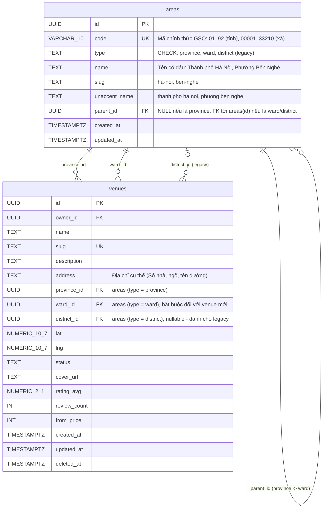
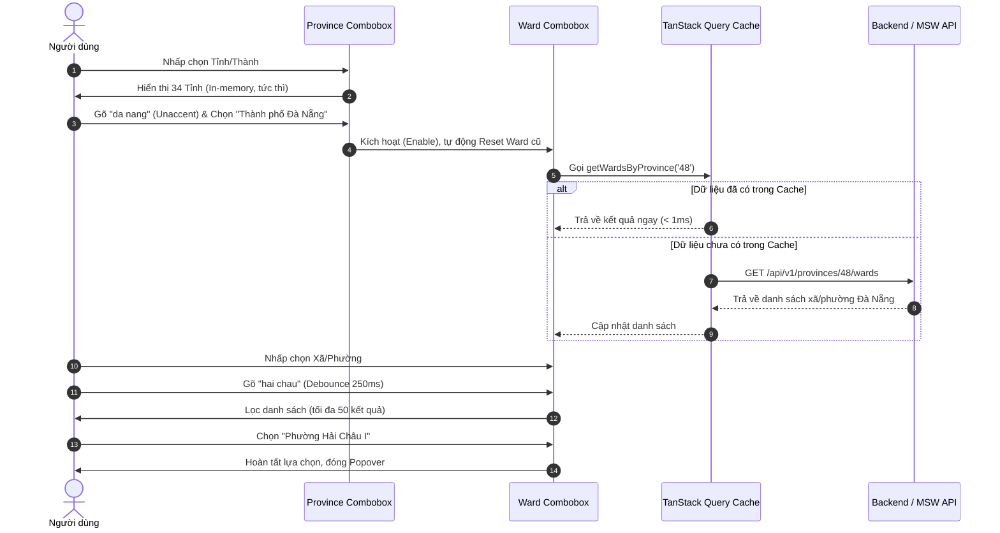

# ĐẶC TẢ KỸ THUẬT: BỘ DỮ LIỆU ĐƠN VỊ HÀNH CHÍNH VIỆT NAM 2 CẤP (34 TỈNH / 3.321 XÃ-PHƯỜNG)
## CẬP NHẬT ĐẾN 03/11/2026 & CHUYỂN ĐỔI TOÀN DIỆN HỆ THỐNG

- **Mã tài liệu:** `SPEC-ADMIN-UNITS-2LEVELS-20261103`
- **Tác giả:** Product Architect & UX Specifier (`ba-spec` — 9router_BA)
- **Dự án:** BookSportsCourt (Sàn thương mại điện tử đặt sân thể thao đa người dùng)
- **Nền tảng mục tiêu:** Monorepo (`apps/web` Next.js 14 App Router, `packages/shared`, `apps/api` NestJS)
- **Trạng thái:** Approved / Sẵn sàng bàn giao cho `senior-dev` (9router_DEV)
- **Mốc hiệu lực dữ liệu:** 03/11/2026 (Nguồn: Tổng cục Thống kê & Cơ sở dữ liệu Quốc gia về Đơn vị Hành chính)
- **Tham chiếu:**
  - `AGENTS.md` (10 quy tắc tối thượng, đặc biệt: #1 Validate BE, #4 Nghiệp vụ chỉ ở API, #5 Type chung ở shared, #6 Token CSS, #7 Lucide icon, #8 Đủ 6 trạng thái UI, #9 Không tự ý thêm dependency)
  - `docs/04-database-schema.md` (Bảng `areas`, `venues`, ràng buộc CHECK, FK)
  - `docs/07-design-system.md` (Design tokens, Slate neutral, Anti-AI Design)
  - `docs/08-ui-quality-rules.md` (Chuẩn trang lớn Linear/Stripe/Vercel)
  - `docs/09-frontend-conventions.md` (Next.js 14 conventions, TanStack Query, Radix UI)
  - `docs/11-api-contract.md` (API contracts, query params, response envelopes)
  - `docs/18-decision-log.md` (Lịch sử ADR, thêm ADR-022, ADR-023, ADR-024)

---

## 1. Bối cảnh & Mục tiêu Chuyển đổi

### 1.1. Hiện trạng Codebase
1. **Dữ liệu Mock tĩnh & Hard-code:**
   - `apps/web/mocks/fixtures/catalogs.ts` chỉ có 5 tỉnh/thành và 9 quận; hoàn toàn không có xã/phường.
   - Khi tìm sân ở các tỉnh khác hoặc xã/phường cụ thể, hệ thống không đáp ứng được.
2. **Cấu trúc dữ liệu lỗi thời:**
   - `packages/shared/src/constants.ts` khai báo `AREA_TYPES = ['province', 'district']`, thiếu cấp `ward`.
   - `packages/shared/src/types.ts` chỉ hỗ trợ `Province`, `District`, `Area` theo mô hình 3 cấp cũ (Tỉnh - Huyện - Xã).
   - `docs/04-database-schema.md` có ràng buộc `CHECK (type IN ('province', 'district'))` và `venues.district_id NOT NULL`.
3. **Cải cách hành chính thực tế tại Việt Nam:**
   - Từ ngày **01/07/2025**, cấp hành chính trung gian (cấp Huyện/Quận/Thị xã/Thành phố thuộc tỉnh) đã chính thức được bãi bỏ trong việc phân cấp quản lý chính quyền địa phương 2 cấp tinh gọn.
   - Toàn quốc phân định thành **2 cấp hành chính**:
     - **Cấp tỉnh:** 34 Tỉnh / Thành phố trực thuộc Trung ương (gồm 6 Thành phố trực thuộc TW: Hà Nội, Hải Phòng, Huế, Đà Nẵng, TP. Hồ Chí Minh, Cần Thơ + 28 Tỉnh).
     - **Cấp cơ sở:** 3.321 Đơn vị hành chính cấp xã (gồm Xã, Phường, và Đặc khu hành chính - kinh tế).
   - Mọi địa chỉ hành chính chuẩn hóa trực tiếp: `[Số nhà/Tên đường/Khu vực], [Xã/Phường/Đặc khu], [Tỉnh/Thành phố]`.

### 1.2. Mục tiêu kỹ thuật & Nghiệp vụ
1. Chuẩn hóa toàn bộ schema, API, shared types, form và UI sang mô hình **2 cấp (Tỉnh/Thành -> Xã/Phường/Đặc khu)**.
2. Giữ `district` chỉ ở vai trò **legacy (deprecated)** để tương thích ngược cho dữ liệu cũ và các bản ghi lịch sử, không xóa dữ liệu đột ngột.
3. Cung cấp bộ dữ liệu đầy đủ **34 Tỉnh/Thành** và **3.321 Xã/Phường/Đặc khu** với mã số chính thức của Tổng cục Thống kê (dạng chuỗi có số 0 ở đầu).
4. Tối ưu bundle size: File 3.321 xã/phường (`wards.json` ~320KB) **KHÔNG ĐƯỢC bundle trực tiếp vào client bundle**, chỉ nạp qua API backend/MSW mock theo tỉnh hoặc tìm kiếm có debounce.
5. Xây dựng component `LocationSelector` chuẩn Anti-AI (Radix Popover + Tailwind có sẵn, zero-dependency mới, hỗ trợ unaccent search, keyboard accessible, đủ 6 trạng thái UI).

---

## 2. Quyết định Kiến trúc Bổ sung (ADR Updates)

Ba quyết định kiến trúc mới bắt buộc được tích hợp vào `docs/18-decision-log.md`:

### 2.1. ADR-022: Chọn Nguồn Bộ Dữ Liệu Đơn Vị Hành Chính Việt Nam Mốc 03/11/2026
- **Trạng thái:** Accepted
- **Bối cảnh:** Dữ liệu hành chính cũ hard-code 5 tỉnh, 9 quận, không phản ánh thực tế địa bàn hoạt động của các cụm sân thể thao trên toàn quốc. Cần nguồn dữ liệu chuẩn hóa, có mã định danh hành chính chính thức (GSO codes), tên gọi tiếng Việt có dấu, slug chuẩn URL, và tên không dấu (unaccent) cho tìm kiếm.
- **Quyết định:**
  - Sử dụng Bộ dữ liệu mở Đơn vị Hành chính Việt Nam được chuẩn hóa từ Tổng cục Thống kê và CSDL Quốc gia về ĐVHC, cập nhật mốc 03/11/2026.
  - Phân tách cấu trúc lưu trữ:
    1. `packages/shared/src/data/provinces.ts`: Chứa 34 tỉnh/thành phố (dưới 5KB), xuất khẩu dạng mảng TypeScript định kiểu chặt chẽ, được phép import cả ở FE và BE.
    2. `packages/shared/src/data/wards.json`: Chứa 3.321 xã/phường/đặc khu (khoảng 320KB). **Chỉ dùng cho BE, Seed DB, và MSW handler server-side.** Tuyệt đối không import vào các client component của Next.js.
  - Mã đơn vị hành chính dùng kiểu `string` bảo toàn số 0 ở đầu (ví dụ: tỉnh Hà Nội là `'01'`, TP.HCM là `'79'`, xã Phúc Xá là `'00001'`).
- **Hệ quả:** Truy vấn xã/phường phía client luôn thông qua API có phân trang hoặc lọc theo tỉnh (`/api/v1/provinces/:code/wards`), tránh làm tăng First Load JS của ứng dụng.

### 2.2. ADR-023: Bãi Bỏ Cấp Huyện — Chuyển Sang Mô Hình 2 Cấp (34 Tỉnh / 3.321 Xã-Phường) & Legacy Support
- **Trạng thái:** Accepted
- **Bối cảnh:** Thể chế quản trị hành chính Việt Nam từ 01/07/2025 bãi bỏ cấp huyện, phân bổ lại thành 34 tỉnh/thành phố và 3.321 xã/phường. Schema hiện tại đang bắt buộc `venues.district_id NOT NULL` và `areas.type IN ('province', 'district')`.
- **Quyết định:**
  - `areas.type` mở rộng chấp nhận `'province'`, `'ward'`, và giữ `'district'` với trạng thái legacy.
  - Bổ sung cột `ward_id UUID REFERENCES areas(id)` vào bảng `venues`.
  - Chuyển `district_id` thành `UUID NULL` (nullable legacy).
  - Nghiệp vụ tạo mới sân (`POST /venues`) và bộ lọc chính của người dùng (`VenueFilters`) chuyển dịch 100% sang cặp `provinceId` + `wardId`.
  - Quy tắc toàn vẹn nghiệp vụ: Bắt buộc xác thực `ward.parent_id === venue.province_id` (hoặc `ward.provinceCode === venue.provinceCode`) trước khi lưu.
- **Hệ quả:** Cần migration có version cho Database; các API cũ vẫn nhận `districtId` nếu client phiên bản cũ gửi lên nhưng sẽ ưu tiên xử lý `wardId`.

### 2.3. ADR-024: Xây Dựng LocationSelector Bằng Radix Popover & Tailwind Có Sẵn (Zero Dependency)
- **Trạng thái:** Accepted
- **Bối cảnh:** Cần trải nghiệm chọn Tỉnh/Thành và Xã/Phường mượt mà: người dùng có thể gõ tìm kiếm tiếng Việt không dấu (ví dụ "cau giay", "tp hcm", "ben nghe"), hiển thị danh sách dạng dropdown có thanh cuộn, không lag khi có nhiều dữ liệu. Theo Quy tắc #9 của `AGENTS.md`, không được tùy tiện cài thêm thư viện (như `react-select`, `downshift`, `cmdk`).
- **Quyết định:**
  - Tận dụng `@radix-ui/react-popover` (đã có trong `apps/web/package.json` phiên bản `^1.1.2`) kết hợp với input tìm kiếm, danh sách ảo hóa nhẹ bằng CSS và các token Tailwind sẵn có.
  - Tách logic thành component `LocationSelector` gồm 2 combobox:
    - `ProvinceCombobox`: Lấy 34 tỉnh từ bộ nhớ/React Query, lọc in-memory tức thì.
    - `WardCombobox`: Bị disable khi chưa chọn Tỉnh. Khi đã chọn Tỉnh, cho phép tìm kiếm xã/phường thuộc tỉnh đó; hỗ trợ debounce 250ms khi gõ từ khóa, giới hạn tối đa 50 kết quả hiển thị.
  - Tích hợp tiện ích chuẩn hóa chuỗi `unaccent` để tìm kiếm không phụ thuộc chữ hoa/thường và dấu tiếng Việt.
- **Hệ quả:** Không phát sinh bất kỳ dependency mới nào, tuân thủ nghiêm ngặt 100% quy tắc kiểm soát phụ thuộc và chuẩn Anti-AI Design.

---

## 3. Đặc tả Sửa đổi CSDL (`docs/04-database-schema.md`) & Migration

### 3.1. Phiên bản Migration: `V20261103_01__administrative_units_2levels.sql`

```sql
-- ============================================================================
-- Migration: V20261103_01__administrative_units_2levels.sql
-- Mục đích: Chuyển đổi mô hình ĐVHC sang 2 cấp (34 tỉnh / 3.321 xã)
-- Ngày cập nhật: 2026-11-03
-- ============================================================================

-- 1. Bổ sung cột mã định danh GSO và tên không dấu cho bảng areas
ALTER TABLE areas
  ADD COLUMN IF NOT EXISTS code VARCHAR(10),
  ADD COLUMN IF NOT EXISTS unaccent_name TEXT;

-- 2. Cập nhật ràng buộc CHECK của areas.type để hỗ trợ 'ward' và giữ 'district' (legacy)
ALTER TABLE areas DROP CONSTRAINT IF EXISTS areas_type_check;
ALTER TABLE areas ADD CONSTRAINT areas_type_check 
  CHECK (type IN ('province', 'ward', 'district'));

-- 3. Cập nhật ràng buộc phân cấp:
--    - 'province': parent_id IS NULL
--    - 'ward' hoặc 'district': parent_id IS NOT NULL
ALTER TABLE areas DROP CONSTRAINT IF EXISTS areas_parent_check;
ALTER TABLE areas ADD CONSTRAINT areas_parent_check 
  CHECK (
    (type = 'province' AND parent_id IS NULL) OR 
    (type IN ('ward', 'district') AND parent_id IS NOT NULL)
  );

-- 4. Bổ sung index tối ưu truy vấn cho areas
CREATE INDEX IF NOT EXISTS idx_areas_code ON areas(code);
CREATE INDEX IF NOT EXISTS idx_areas_type_parent ON areas(type, parent_id);
CREATE INDEX IF NOT EXISTS idx_areas_unaccent_trgm ON areas USING gin (unaccent_name gin_trgm_ops);

-- 5. Cập nhật bảng venues: thêm ward_id, nới lỏng district_id thành NULL
ALTER TABLE venues 
  ADD COLUMN IF NOT EXISTS ward_id UUID REFERENCES areas(id) ON DELETE RESTRICT;

ALTER TABLE venues 
  ALTER COLUMN district_id DROP NOT NULL;

-- 6. Index cho venues theo cặp tỉnh - xã mới
CREATE INDEX IF NOT EXISTS idx_venues_province_ward 
  ON venues(province_id, ward_id) WHERE deleted_at IS NULL;

-- 7. Trigger kiểm tra tính toàn vẹn: ward_id phải có parent_id trùng khớp với province_id
CREATE OR REPLACE FUNCTION check_venue_ward_province_match() RETURNS TRIGGER AS $$
DECLARE
  v_ward_parent UUID;
BEGIN
  IF NEW.ward_id IS NOT NULL THEN
    SELECT parent_id INTO v_ward_parent FROM areas WHERE id = NEW.ward_id;
    IF v_ward_parent IS NULL OR v_ward_parent <> NEW.province_id THEN
      RAISE EXCEPTION 'Lỗi toàn vẹn dữ liệu: Xã/phường (%) không trực thuộc Tỉnh/thành phố (%) đã chọn', 
        NEW.ward_id, NEW.province_id
        USING ERRCODE = 'check_violation';
    END IF;
  END IF;
  RETURN NEW;
END;
$$ LANGUAGE plpgsql;

DROP TRIGGER IF EXISTS trg_venues_ward_province_match ON venues;
CREATE TRIGGER trg_venues_ward_province_match
BEFORE INSERT OR UPDATE OF province_id, ward_id ON venues
FOR EACH ROW EXECUTE FUNCTION check_venue_ward_province_match();
```

### 3.2. Cập nhật Mô hình Physical Schema trong `docs/04-database-schema.md`



---

## 4. Đặc tả Hợp đồng API (`docs/11-api-contract.md`)

### 4.1. Endpoint Danh mục ĐVHC

#### `GET /api/v1/provinces`
- **Mô tả:** Lấy toàn bộ 34 Tỉnh / Thành phố trực thuộc Trung ương.
- **Quyền hạn:** Công khai (Public).
- **Cache Header:** `Cache-Control: public, max-age=86400, stale-while-revalidate=604800` (24 giờ).
- **Response 200 OK:**
  ```json
  {
    "data": [
      {
        "id": "019273c5-7f00-7000-0000-000000000001",
        "code": "01",
        "name": "Thành phố Hà Nội",
        "slug": "ha-noi",
        "unaccentName": "thanh pho ha noi",
        "isMunicipality": true
      },
      {
        "id": "019273c5-7f00-7000-0000-000000000079",
        "code": "79",
        "name": "Thành phố Hồ Chí Minh",
        "slug": "ho-chi-minh",
        "unaccentName": "thanh pho ho chi minh",
        "isMunicipality": true
      }
    ]
  }
  ```

#### `GET /api/v1/provinces/:code/wards`
- **Mô tả:** Lấy danh sách toàn bộ Xã/Phường/Đặc khu trực thuộc một Tỉnh/Thành phố.
- **Tham số Path:** `code` (string 2 số, ví dụ `01`, `79`, hoặc `id` UUID của tỉnh).
- **Tham số Query:** `q` (string, tùy chọn): Lọc theo tên xã/phường (hỗ trợ không dấu).
- **Cache Header:** `Cache-Control: public, max-age=3600, stale-while-revalidate=86400`.
- **Response 200 OK:**
  ```json
  {
    "data": [
      {
        "id": "019273c5-7f00-7000-0001-000000000001",
        "code": "00001",
        "name": "Phường Phúc Xá",
        "slug": "phuc-xa",
        "type": "ward",
        "provinceCode": "01",
        "unaccentName": "phuong phuc xa"
      },
      {
        "id": "019273c5-7f00-7000-0001-000000000004",
        "code": "00004",
        "name": "Phường Trúc Bạch",
        "slug": "truc-bach",
        "type": "ward",
        "provinceCode": "01",
        "unaccentName": "phuong truc bach"
      }
    ]
  }
  ```

#### `GET /api/v1/wards/search`
- **Mô tả:** Tìm kiếm xã/phường hỗ trợ autocomplete debounce.
- **Tham số Query:**
  - `q` (bắt buộc, string, min 1 ký tự): Từ khóa tìm kiếm.
  - `provinceCode` (tùy chọn, 2 chữ số): Giới hạn trong tỉnh.
  - `limit` (tùy chọn, mặc định 50, tối đa 100).
- **Response 200 OK:**
  ```json
  {
    "data": [
      {
        "id": "019273c5-7f00-7000-0001-000000000001",
        "code": "00001",
        "name": "Phường Phúc Xá",
        "slug": "phuc-xa",
        "type": "ward",
        "provinceCode": "01",
        "provinceName": "Thành phố Hà Nội"
      }
    ],
    "meta": {
      "total": 1,
      "limit": 50
    }
  }
  ```

#### Legacy Endpoint Support: `GET /api/v1/provinces/:id/districts`
- Giữ nguyên endpoint để các client cũ không bị lỗi 404, trả về mảng rỗng `[]` hoặc danh sách quận lịch sử của tỉnh đó kèm header `X-Deprecated: true`.

---

### 4.2. Cập nhật Endpoints Tìm kiếm & Quản trị Venue

#### `GET /api/v1/venues`
- **Bổ sung tham số Query:**
  - `provinceId` (UUID string): Lọc theo tỉnh.
  - `provinceCode` (string 2 số): Lọc theo mã tỉnh.
  - `wardId` (UUID string): Lọc theo xã/phường.
  - `wardCode` (string 5 số): Lọc theo mã xã/phường.
  - `districtId` (UUID string, deprecated): Vẫn được tiếp nhận để backward-compatible.

#### `POST /api/v1/venues` & `PATCH /api/v1/venues/:id`
- **Request Body Payload (JSON):**
  ```json
  {
    "name": "Sân Cầu Lông Ba Đình",
    "description": "Sân tiêu chuẩn thi đấu...",
    "address": "123 Hoàng Hoa Thám",
    "provinceId": "019273c5-7f00-7000-0000-000000000001",
    "wardId": "019273c5-7f00-7000-0001-000000000001",
    "districtId": null,
    "lat": 21.0378,
    "lng": 105.8234,
    "amenityIds": []
  }
  ```
- **Validation Rules BE (Quy tắc #1 & #4):**
  - Trả lỗi `422 Unprocessable Entity` nếu `wardId` không trực thuộc `provinceId`:
    ```json
    {
      "error": {
        "code": "VALIDATION_ERROR",
        "message": "Dữ liệu không hợp lệ",
        "details": {
          "wardId": ["Xã/phường đã chọn không thuộc Tỉnh/thành phố tương ứng"]
        }
      }
    }
    ```

---

## 5. Đặc tả Gói Dùng Chung (`packages/shared`)

### 5.1. File `packages/shared/src/constants.ts`

```typescript
// ===== Danh mục Hành chính 2 Cấp (Mốc 03/11/2026) =====

export const AREA_TYPES = ['province', 'ward'] as const;
export type AreaType = (typeof AREA_TYPES)[number];

export const LEGACY_AREA_TYPES = ['district'] as const;
export type LegacyAreaType = (typeof LEGACY_AREA_TYPES)[number];

export const ALL_AREA_TYPES = ['province', 'ward', 'district'] as const;
export type AllAreaType = (typeof ALL_AREA_TYPES)[number];

export const WARD_TYPES = ['ward', 'commune', 'special_zone'] as const;
export type WardType = (typeof WARD_TYPES)[number];

/** Phiên bản bộ dữ liệu ĐVHC cập nhật hệ thống */
export const ADMIN_UNITS_VERSION = '2026-11-03' as const;

/** Tên nguồn dữ liệu hiển thị trên giao diện người dùng */
export const ADMIN_UNITS_SOURCE_NAME = 'Tổng cục Thống kê & CSDL Quốc gia về Đơn vị Hành chính' as const;

/** Số lượng đơn vị hành chính chuẩn hóa */
export const ADMIN_UNITS_PROVINCES_COUNT = 34 as const;
export const ADMIN_UNITS_WARDS_COUNT = 3321 as const;
```

### 5.2. File `packages/shared/src/types.ts`

```typescript
// ===== Đơn vị Hành chính =====

export interface Province {
  id: string;              // UUID
  code: string;            // '01'..'92' (chuỗi 2 chữ số bảo toàn số 0)
  name: string;            // 'Thành phố Hà Nội'
  slug: string;            // 'ha-noi'
  unaccentName?: string;   // 'thanh pho ha noi'
  isMunicipality?: boolean;// true cho 6 Thành phố trực thuộc TW
  sortOrder?: number;
}

export interface Ward {
  id: string;              // UUID
  code: string;            // '00001'..'33210' (chuỗi 5 chữ số bảo toàn số 0)
  name: string;            // 'Phường Phúc Xá', 'Xã Tân Triều', 'Đặc khu Vân Đồn'
  slug: string;            // 'phuc-xa'
  provinceCode: string;    // '01' (mã tỉnh trực thuộc)
  provinceId?: string;     // UUID của tỉnh
  provinceName?: string;   // Tên tỉnh (khi trả về từ search)
  type: WardType;          // 'ward' | 'commune' | 'special_zone'
  unaccentName?: string;   // 'phuong phuc xa'
}

export interface LegacyDistrict {
  id: string;
  code?: string;
  name: string;
  slug: string;
  provinceId: string;
}

export interface Area {
  id: string;
  code?: string;
  name: string;
  slug: string;
  type: AllAreaType;
  parentId: string | null;
}

export interface AdminUnitDataset {
  version: string;
  updatedAt: string;
  provincesCount: number;
  wardsCount: number;
  source: string;
}
```

### 5.3. File `packages/shared/src/schemas.ts`

```typescript
// ===== Schemas Xác thực ĐVHC =====

export const provinceCodeSchema = z
  .string()
  .trim()
  .regex(/^\d{2}$/, 'Mã tỉnh/thành phố phải gồm đúng 2 chữ số (ví dụ: 01, 79)');

export const wardCodeSchema = z
  .string()
  .trim()
  .regex(/^\d{5}$/, 'Mã xã/phường/đặc khu phải gồm đúng 5 chữ số (ví dụ: 00001, 26734)');

// Cập nhật venueSearchSchema
export const venueSearchSchema = z.object({
  q: z.string().trim().max(100).optional(),
  provinceId: uuidSchema.optional(),
  provinceCode: provinceCodeSchema.optional(),
  wardId: uuidSchema.optional(),
  wardCode: wardCodeSchema.optional(),
  districtId: uuidSchema.optional(), // legacy compatibility
  sportIds: z.array(uuidSchema).optional(),
  amenityIds: z.array(uuidSchema).optional(),
  minPrice: z.coerce.number().int().nonnegative().optional(),
  maxPrice: z.coerce.number().int().nonnegative().optional(),
  minRating: z.coerce.number().min(0).max(5).optional(),
  date: dateOnlySchema.optional(),
  sort: venueSortSchema.optional(),
  page: z.coerce.number().int().positive().default(1),
  limit: z.coerce.number().int().positive().max(100).default(20),
});

// Cập nhật createVenueSchema với validation kiểm tra logic
export const createVenueSchema = z
  .object({
    name: z.string().min(2, 'Vui lòng nhập tên cơ sở').max(200).trim(),
    description: z.string().max(5000).optional(),
    address: z.string().min(5, 'Vui lòng nhập địa chỉ cụ thể (số nhà, tên đường)').max(500).trim(),
    provinceId: uuidSchema,
    provinceCode: provinceCodeSchema.optional(),
    wardId: uuidSchema,
    wardCode: wardCodeSchema.optional(),
    districtId: uuidSchema.optional(), // legacy compatibility
    lat: z.coerce.number().min(-90).max(90),
    lng: z.coerce.number().min(-180).max(180),
    amenityIds: z.array(uuidSchema).default([]),
  });

// Cập nhật areaSchema cho quản trị
export const areaSchema = z
  .object({
    name: z.string().min(1, 'Vui lòng nhập tên khu vực').max(100).trim(),
    code: z.string().regex(/^\d{2,5}$/, 'Mã khu vực gồm 2 đến 5 chữ số').optional(),
    slug: z
      .string()
      .min(1, 'Vui lòng nhập slug')
      .max(100)
      .regex(/^[a-z0-9-]+$/, 'Slug chỉ gồm chữ thường, số và dấu gạch nối'),
    type: z.enum(['province', 'ward', 'district']),
    parentId: uuidSchema.nullish(),
  })
  .refine(
    (d) => {
      if ((d.type === 'ward' || d.type === 'district') && !d.parentId) {
        return false;
      }
      return true;
    },
    {
      message: 'Đơn vị hành chính trực thuộc phải chọn địa bàn cấp trên',
      path: ['parentId'],
    },
  );
```

### 5.4. Tiện ích Unaccent Dùng Chung: `packages/shared/src/utils/unaccent.ts`

```typescript
/**
 * Chuyển chuỗi tiếng Việt có dấu thành không dấu, viết thường, loại bỏ ký tự đặc biệt.
 * Dùng cho Autocomplete và Client-side filter.
 */
export function toUnaccent(str: string): string {
  if (!str) return '';
  return str
    .normalize('NFD')
    .replace(/[̀-ͯ]/g, '')
    .replace(/đ/g, 'd')
    .replace(/Đ/g, 'D')
    .toLowerCase()
    .trim();
}
```

### 5.5. Cấu trúc Dataset Files

1. **`packages/shared/src/data/provinces.ts`** (Nhẹ, ~4.5KB):
   Xuất danh sách đầy đủ 34 tỉnh/thành phố, bao gồm 6 Thành phố trực thuộc Trung ương:
   - `'01'`: Thành phố Hà Nội (`isMunicipality: true`)
   - `'31'`: Thành phố Hải Phòng (`isMunicipality: true`)
   - `'46'`: Thành phố Huế (`isMunicipality: true`)
   - `'48'`: Thành phố Đà Nẵng (`isMunicipality: true`)
   - `'79'`: Thành phố Hồ Chí Minh (`isMunicipality: true`)
   - `'92'`: Thành phố Cần Thơ (`isMunicipality: true`)
   Và 28 tỉnh còn lại được đánh số định danh chính thức: `'02'`, `'04'`, `'08'`, `'19'`, `'20'`, `'22'`, `'24'`, `'25'`, `'26'`, `'27'`, `'30'`, `'33'`, `'34'`, `'35'`, `'36'`, `'37'`, `'38'`, `'40'`, `'42'`, `'44'`, `'45'`, `'49'`, `'51'`, `'52'`, `'56'`, `'68'`, `'74'`, `'77'`.
2. **`packages/shared/src/data/wards.json`** (3.321 đơn vị, ~320KB):
   Lưu trữ danh sách mảng JSON gọn gàng gồm `{ id, code, name, slug, provinceCode, type }`.
   **CHỈ ĐƯỢC PHÉP IMPORT TRONG:** Backend Drizzle seed, NestJS API service, hoặc MSW handlers server-side (`apps/web/mocks/`).

---

## 6. Đặc tả Kiến trúc Frontend Component & UX Flow

### 6.1. Component `LocationSelector.tsx` (`apps/web/components/common/LocationSelector.tsx`)

#### 6.1.1. Yêu cầu Giao diện & Anti-AI Design
- **Không dùng gradient neon, không dùng bo góc quá đà:** Sử dụng `rounded-input` (`8px`) và `border border-neutral-300 dark:border-neutral-700`.
- **Không dùng emoji rác:** Dùng icon Lucide với kích thước đồng nhất `size-4 text-neutral-500` (`Check`, `ChevronsUpDown`, `MapPin`, `Search`, `X`).
- **Đủ 6 trạng thái UI bắt buộc (Quy tắc #8):**
  1. `Default`: Nền `bg-bg-card`, viền `border-neutral-300`, chữ `text-neutral-900`.
  2. `Hover`: Viền `border-neutral-400`, nền `hover:bg-neutral-50/50`.
  3. `Focus-visible`: Đường viền kép rõ nét `focus-visible:ring-2 focus-visible:ring-primary-600 focus-visible:border-transparent`.
  4. `Loading`: Hiển thị `Spinner` xoay mượt cạnh chữ "Đang tải dữ liệu..." hoặc skeleton mờ `Skeleton className="h-10 w-full"`.
  5. `Disabled`: Khi chưa chọn Tỉnh, ô chọn Xã bị disabled mờ `opacity-50 cursor-not-allowed bg-neutral-100 dark:bg-neutral-800`.
  6. `Validation Error`: Viền đỏ `border-danger text-danger focus-visible:ring-danger`, thông báo lỗi inline ngay bên dưới ô nhập.

#### 6.1.2. Luồng Tương Tác (User Flow)


#### 6.1.3. Cấu trúc Props & Component API
```typescript
export interface LocationSelectorProps {
  provinceId?: string;
  provinceCode?: string;
  wardId?: string;
  wardCode?: string;
  onProvinceChange: (province: Province | null) => void;
  onWardChange: (ward: Ward | null) => void;
  disabled?: boolean;
  error?: {
    province?: string;
    ward?: string;
  };
  layout?: 'horizontal' | 'vertical' | 'compact';
  showFooterNotice?: boolean;
  className?: string;
}
```

#### 6.1.4. Cơ chế Caching & Resilience
- **TanStack Query Cache:**
  - `['catalogs', 'provinces']`: `staleTime: 24 * 60 * 60 * 1000` (24 giờ), `gcTime: 48 * 60 * 60 * 1000`.
  - `['catalogs', 'wards', provinceCode]`: `staleTime: 30 * 60 * 1000` (30 phút).
- **LocalStorage Fallback:**
  - Key: `bsc:admin-units:v2026-11-03`.
  - Lưu trữ snapshot 34 tỉnh để khi người dùng vừa load trang, danh sách tỉnh render ngay lập tức mà không có CLS (Cumulative Layout Shift).

---

### 6.2. Tích hợp Component vào các Màn hình

#### 6.2.1. `VenueFilters.tsx` (`apps/web/components/features/venue/VenueFilters.tsx`)
- Thay thế 2 thẻ `<NativeSelect>` Tỉnh & Quận cũ bằng `LocationSelector` (hoặc cặp combobox tích hợp).
- Khi chọn Tỉnh mới -> tự động xóa `wardId` và `districtId` khỏi `filterValues`, đồng thời đặt `page = 1`.
- **Dòng ghi chú bản quyền & mốc dữ liệu:** Đặt tại footer của `VenueFilters`:
  ```tsx
  <div className="mt-3 border-t border-neutral-100 pt-2 text-right">
    <p className="text-[11px] text-neutral-400">
      Dữ liệu hành chính cập nhật đến 03/11/2026 — Nguồn: Tổng cục Thống kê &amp; CSDL Quốc gia về Đơn vị Hành chính
    </p>
  </div>
  ```

#### 6.2.2. `VenueFormDialog.tsx` (`apps/web/components/features/owner/venues/VenueFormDialog.tsx`)
- Thay thế dropdown cũ bằng `LocationSelector`.
- Đồng bộ tọa độ tâm bản đồ (`VenueLocationMapWrapper`):
  - Khi người dùng chọn Tỉnh, nếu chưa có tọa độ ghim cụ thể, bản đồ tự động di chuyển về tọa độ trung tâm của Tỉnh đó (ví dụ Hà Nội: `[21.0285, 105.8542]`, TP.HCM: `[10.7769, 106.7008]`, Đà Nẵng: `[16.0471, 108.2068]`, Huế: `[16.4637, 107.5909]`, Cần Thơ: `[10.0452, 105.7469]`).
- Validate trước khi submit: Bắt buộc chọn cả Tỉnh và Xã/Phường. Kiểm tra `ward.provinceCode === province.code`.

#### 6.2.3. `AreaFormDialog.tsx` & `AreasCatalogTab.tsx` (Phân hệ Admin)
- Trong `AreaFormDialog.tsx`: Cung cấp 2 lựa chọn loại địa bàn chính:
  1. `province`: Tỉnh / Thành phố trực thuộc Trung ương.
  2. `ward`: Xã / Phường / Đặc khu trực thuộc.
  3. Lựa chọn `district` được gắn nhãn `[Legacy] Quận / Huyện`.
- Trong `AreasCatalogTab.tsx`:
  - Hiển thị thống kê tổng quan: **34 Tỉnh/Thành phố**, **3.321 Xã/Phường/Đặc khu**.
  - Cho phép Admin lọc xã/phường theo từng Tỉnh, tìm kiếm nhanh theo mã hoặc tên không dấu.

#### 6.2.4. `AdminVenuesScreen.tsx` & `VenueReviewDrawer.tsx`
- Cập nhật hiển thị địa chỉ của cơ sở theo định dạng chuẩn hóa:
  `{venue.address}, {venue.wardName || 'Xã/Phường'}, {venue.provinceName}`.

#### 6.2.5. Trang Tìm Sân `apps/web/app/(public)/venues/page.tsx`
- Cập nhật URL sync: Đồng bộ `provinceId`, `provinceCode`, `wardId`, `wardCode`.
- Hỗ trợ fallback: Nếu URL chứa `districtId` cũ, query vẫn chạy bình thường mà không gây lỗi giao diện.

---

## 7. Đặc tả MSW Mock Engine (`apps/web/mocks/`)

### 7.1. Cập nhật `apps/web/mocks/fixtures/catalogs.ts`
- Import 34 tỉnh từ `@bsc/shared/data/provinces`.
- Cung cấp dữ liệu mẫu xã/phường cho 6 Thành phố lớn (Hà Nội, TP.HCM, Đà Nẵng, Huế, Hải Phòng, Cần Thơ) và các tỉnh chính để phục vụ demo E2E mượt mà.
- Giữ mảng `districts` cũ với cờ `legacy: true` để tránh vỡ các kịch bản test cũ.

### 7.2. Cập nhật `apps/web/mocks/handlers/catalog.ts`
- Thêm handlers:
  - `http.get('/api/v1/provinces', ...)` -> Trả về 34 tỉnh.
  - `http.get('/api/v1/provinces/:code/wards', ...)` -> Trả về danh sách xã/phường tương ứng.
  - `http.get('/api/v1/wards/search', ...)` -> Tìm kiếm xã/phường với unaccent, limit 50.
- Giữ `http.get('/api/v1/provinces/:id/districts', ...)` tương thích legacy.

### 7.3. Cập nhật `apps/web/mocks/fixtures/venues.ts` & `apps/web/mocks/db.ts`
- Cập nhật các bản ghi fixture của 6 sân mẫu trong `venues.ts`: Bổ sung `wardId` hợp lệ tương ứng với `provinceId`.
- Cập nhật hàm lọc venue trong `mocks/handlers/venues.ts` để lọc chuẩn xác theo `wardId` bên cạnh `provinceId`.

---

## 8. Test Matrix Nghiệm thu Chi tiết (11 Tiêu chí)

Bảng test matrix bắt buộc dành cho Subagent `auto-tester` và `qa-inspector` kiểm thử:

| Mã Test | Tên Tiêu Chí | Đầu Vào (Input) | Hành Động (Action) | Kết Quả Kỳ Vọng (Expected Output) | Cấp Độ Test |
|---|---|---|---|---|:---:|
| **TC-LOC-01** | Render đủ 34 Tỉnh/Thành phố | Mở `LocationSelector` hoặc `VenueFilters` | Nhấp mở danh sách Tỉnh | Render chính xác 34 Tỉnh/Thành (đầy đủ 6 TP trực thuộc TW gồm Hà Nội, Hải Phòng, Huế, Đà Nẵng, TP.HCM, Cần Thơ + 28 tỉnh). | Unit / Component |
| **TC-LOC-02** | Reset Xã khi đổi Tỉnh | Đã chọn Tỉnh A và Xã A | Chọn sang Tỉnh B | Giá trị Xã tự động reset về rỗng, `onWardChange(null)` được kích hoạt, không giữ lại xã của tỉnh cũ. | Unit / Component |
| **TC-LOC-03** | Khóa Combobox Xã khi chưa chọn Tỉnh | Chưa chọn Tỉnh (`provinceId = null`) | Kiểm tra trạng thái Combobox Xã | Ô chọn Xã ở trạng thái `disabled`, có con trỏ `not-allowed`, hiển thị placeholder "Chọn Tỉnh/Thành trước". | Component / A11y |
| **TC-LOC-04** | Tìm kiếm Tiếng Việt không dấu (Unaccent) | Gõ "ha noi", "tp hcm", "hai chau", "ben nghe" | Nhập vào ô tìm kiếm | Kết quả trả về đúng: "Thành phố Hà Nội", "Thành phố Hồ Chí Minh", "Phường Hải Châu I", "Phường Bến Nghé". | Unit Test |
| **TC-LOC-05** | Debounce tìm kiếm Xã/Phường | Gõ liên tục các ký tự trong 200ms | Quan sát network/hàm search | Chỉ phát ra duy nhất 1 request tìm kiếm sau 250ms ngừng gõ, không spam request. | Unit / Integration |
| **TC-LOC-06** | Giới hạn tối đa 50 kết quả tìm kiếm Xã | Tìm từ khóa phổ biến (ví dụ "Tân", "An") có > 100 kết quả | Thực hiện tìm kiếm | Danh sách hiển thị tối đa 50 kết quả, kèm thông báo "Hiển thị 50 kết quả đầu tiên" nếu vượt quá. | Component / Perf |
| **TC-LOC-07** | Xác thực Toàn vẹn Xã - Tỉnh trước khi lưu | Payload chứa `provinceCode = '01'` nhưng `ward.provinceCode = '79'` | Submit form `POST /venues` | Schema Zod hoặc Form chặn lại với lỗi `VALIDATION_ERROR`: "Xã/phường không thuộc Tỉnh/thành phố đã chọn". | Unit / Schema |
| **TC-LOC-08** | Định dạng Mã Hành chính có số 0 ở đầu | Mã `'01'`, `'00001'` | Kiểm tra qua `provinceCodeSchema` và `wardCodeSchema` | Schema chấp nhận chuỗi có số 0 đầu, từ chối số nguyên `1` hoặc chuỗi sai độ dài (`'1'`, `'001'`). | Unit / Schema |
| **TC-LOC-09** | Hiển thị Dòng Ghi chú & Mốc Thời gian | Màn hình `VenueFilters` | Cuộn xuống chân bộ lọc | Hiển thị nguyên văn: "Dữ liệu hành chính cập nhật đến 03/11/2026 — Nguồn: Tổng cục Thống kê & CSDL Quốc gia về Đơn vị Hành chính". | E2E / Visual |
| **TC-LOC-10** | Tương thích ngược Legacy District | Venue cũ chỉ có `districtId`, không có `wardId` | Render thẻ `VenueCard` & Chi tiết sân | Không gây crash màn hình (No runtime exception), fallback hiển thị tên quận cũ nếu có. | Integration |
| **TC-LOC-11** | Bundle Size Guard (Không bundle `wards.json`) | Kiểm tra client build chunk của Next.js | Chạy `next build` hoặc kiểm tra bundle report | File `wards.json` không nằm trong client-side bundle chunk, First Load JS không tăng quá 15KB. | QA / Build Check |

---

## 9. Danh mục File Cần Tạo & Chỉnh Sửa

### 9.1. Gói Dùng Chung (`packages/shared/`)
- `packages/shared/src/constants.ts`: Cập nhật `AREA_TYPES`, `LEGACY_AREA_TYPES`, `ADMIN_UNITS_VERSION`.
- `packages/shared/src/types.ts`: Cập nhật `Province`, `Ward`, `Area`, `VenueSearchParams`.
- `packages/shared/src/schemas.ts`: Cập nhật `provinceCodeSchema`, `wardCodeSchema`, `venueSearchSchema`, `createVenueSchema`, `areaSchema`.
- `packages/shared/src/utils/unaccent.ts`: Tạo mới tiện ích chuẩn hóa chuỗi không dấu.
- `packages/shared/src/data/provinces.ts`: Tạo mới danh sách 34 tỉnh/thành phố chuẩn hóa.
- `packages/shared/src/data/wards.json`: Tạo mới danh sách 3.321 xã/phường cho server/mock.
- `packages/shared/src/index.ts`: Re-export các constants, types, schemas và utils mới.

### 9.2. Tài liệu Dự án (`docs/`)
- `docs/18-decision-log.md`: Thêm ADR-022, ADR-023, ADR-024.
- `docs/04-database-schema.md`: Cập nhật mô hình `areas` và `venues`, bổ sung SQL migration.
- `docs/11-api-contract.md`: Bổ sung endpoints `/provinces`, `/provinces/:code/wards`, `/wards/search`.

### 9.3. Ứng dụng Web (`apps/web/`)
- `apps/web/components/common/LocationSelector.tsx`: Tạo mới component chọn địa bàn chuẩn Anti-AI.
- `apps/web/components/common/LocationSelector.test.tsx`: Test suites cho component mới.
- `apps/web/lib/api/endpoints/venues.ts`: Bổ sung API `listProvinces`, `listWardsByProvince`, `searchWards`.
- `apps/web/components/features/venue/VenueFilters.tsx`: Tích hợp `LocationSelector`, thêm footer mốc thời gian.
- `apps/web/components/features/venue/VenueFilters.test.tsx`: Cập nhật unit test khớp với 34 tỉnh và xã.
- `apps/web/components/features/owner/venues/VenueFormDialog.tsx`: Cập nhật form tạo sân 2 cấp.
- `apps/web/components/features/admin/AreaFormDialog.tsx`: Cập nhật form tạo địa bàn.
- `apps/web/components/features/admin/AreasCatalogTab.tsx`: Cập nhật giao diện quản lý danh mục địa bàn.
- `apps/web/app/(public)/venues/page.tsx`: Cập nhật query URL đồng bộ xã/phường.
- `apps/web/mocks/fixtures/catalogs.ts`: Cập nhật mock 34 tỉnh và xã/phường.
- `apps/web/mocks/fixtures/venues.ts`: Cập nhật fixtures venue với `wardId`.
- `apps/web/mocks/handlers/catalog.ts`: Cập nhật MSW handlers cho provinces và wards.
- `apps/web/mocks/handlers/venues.ts`: Cập nhật handler tìm kiếm venue theo xã/phường.

---

## 10. Hướng Dẫn Chuyển Giao Cho Senior-Dev (`senior-dev`)
1. Đọc kỹ file spec này trước khi bắt đầu viết code.
2. Tuân thủ thứ tự triển khai:
   - Bước 1: Hoàn thiện `packages/shared` (`constants.ts`, `types.ts`, `schemas.ts`, `utils/unaccent.ts`, `data/provinces.ts`, `data/wards.json`).
   - Bước 2: Cập nhật tài liệu (`docs/18-decision-log.md`, `docs/04-database-schema.md`, `docs/11-api-contract.md`).
   - Bước 3: Cập nhật mock data và MSW handlers (`apps/web/mocks/`).
   - Bước 4: Xây dựng `LocationSelector.tsx` và tích hợp vào `VenueFilters.tsx`, `VenueFormDialog.tsx`, `AreaFormDialog.tsx`.
   - Bước 5: Chạy typecheck và lint để đảm bảo zero errors trước khi bàn giao cho `auto-tester`.
3. Tuyệt đối không thêm bất kỳ package bên ngoài nào (không vi phạm Quy tắc #9).
4. Đảm bảo giao diện 100% tuân thủ chuẩn Anti-AI Design (không gradient neon, không bo góc lố, đầy đủ 6 trạng thái UI).
